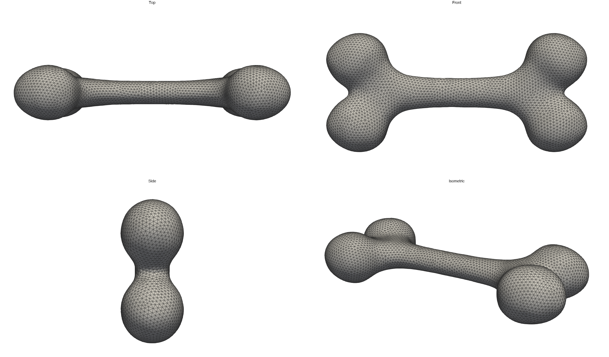
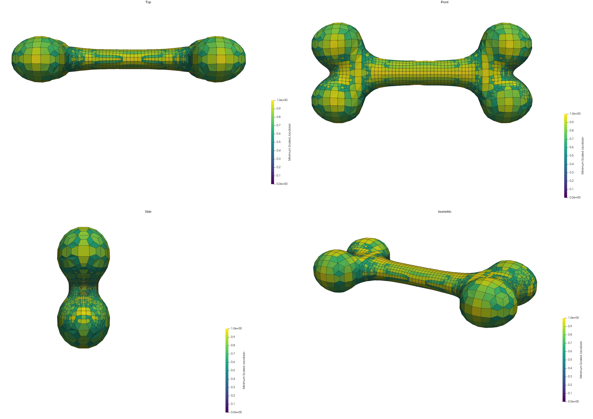
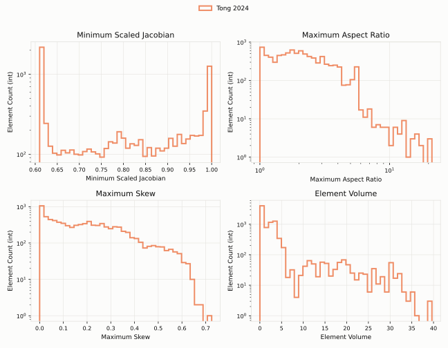
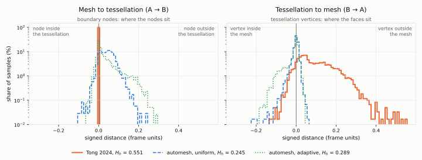
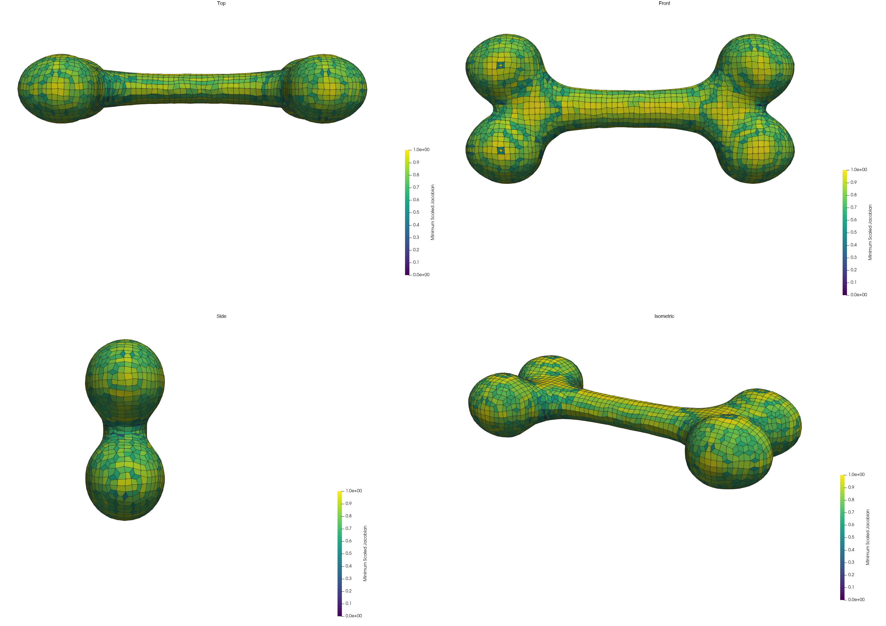
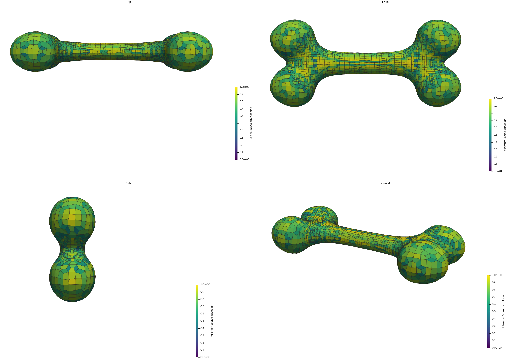
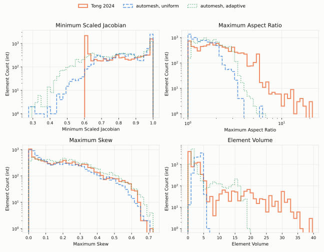
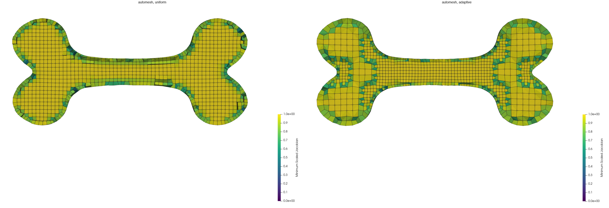
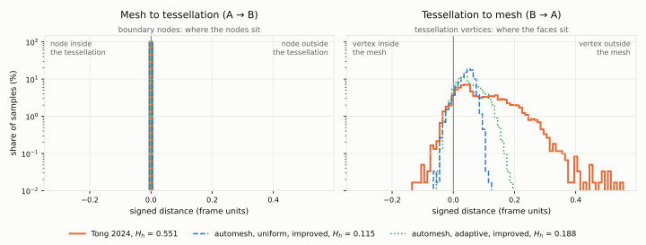

# Bone

The bone is a closed surface of 12,088 triangles.  A long, slender shaft
joins a pair of rounded lobes at each end.  The model comes from the
hybrid-octree meshing work of Tong, Halilaj, and Zhang
[[1]](#references), which meshes it with all-hexahedral elements.

<figure>



<figcaption>

The bone surface, 12,088 triangles, in the top, front, side, and
isometric views.  The triangles are close to uniform.  The longest edge is
about twice the shortest.  ParaView 5.10.1 makes the renders from
`bone_tri_cleaned.stl` (see [Downloads](#downloads)).  They come from
[`bone_render.py`](bone_render.py), and
[`bone_render_quad.py`](bone_render_quad.py) composes them.

</figcaption>
</figure>

The Tong 2024 is the baseline in this book.  This page records the baseline: the settings that
produced it, its size, and its element quality.  Then it meshes the same
surface with `automesh` and compares the two.  The
[Tong 2024 review](https://github.com/hovey/HybridOctree_Hex/blob/main/review_of_tong_2024.md)
describes the method.

The method refines an octree by surface curvature and by wall thickness.  It
turns the octree into hexahedra, then projects the boundary onto the surface.
The code rescales each model so that its longest side spans 100 units.  All
lengths and volumes below use that scale.

## The Baseline Settings

The code, `HybridOctree_Hex` v1.0 [[1]](#references), ships with the settings
below.  Four are constants in `Initialization.h`: `C_THRES`, `H_THRES`,
`CELL_DETECT`, and `VOXEL_SIZE`.  The curvature formula and the level of the
deepest rung are fixed inside `HexGen.cpp`.  The published mesh comes from these
settings, as
[Reproducing the Baseline](#reproducing-the-baseline) shows.

| setting | value | what it sets |
| --- | --- | --- |
| curvature formula | $(\theta - \pi)^2$, summed over the edges at a vertex; fixed in the code | how sharply the surface bends at a vertex |
| `C_THRES` | {0.15, 0.3, 0.6, 1.2, 2.4} | the curvature ladder |
| `H_THRES` | {16, 8, 4, 2, 1} | the thickness ladder |
| `CELL_DETECT` | 1 | which cells a vertex or triangle can split |
| `VOXEL_SIZE` | 9 | the depth budget of the octree |
| `LADDER_TOP` | 8 | the octree level of the deepest rung; fixed in the code |

**Curvature.**  At each surface vertex, the code looks at every edge that
meets the vertex.  Two triangles share each edge.  The angle $\theta$ between
them equals $\pi$ on a flat surface.  The code squares the deviation
$(\theta - \pi)$ and sums it over the edges.  The sum has units of radians
squared, and nothing normalizes it.  A vertex with many small triangles
around it therefore gathers more terms than one with a few large triangles.

**`C_THRES`.**  This is the curvature ladder.  It has five rungs in ascending
order.  Each rung guards one octree level.  A cell at that level splits when a
vertex inside it carries a curvature above the rung.

**`H_THRES`.**  This is the thickness ladder, over the same five levels.  Its
rungs descend.  The code measures the thickness at each triangle.  It casts a
ray from the triangle's centroid along its normal, and takes the distance to
the opposite surface.  A cell splits when a triangle inside it is thinner than
the rung.  A cell splits when either ladder says so.

**`CELL_DETECT`.**  This is a search half-width, measured in cell widths from
each cell's center.  The value 1 tests a box twice the linear extent of the
cell.  A vertex or triangle up to half a cell outside the cell still splits
it.  A larger value refines more.

**`VOXEL_SIZE` and `LADDER_TOP`.**  `VOXEL_SIZE` is the base-2 logarithm of the
octree's depth budget.  The value 9 allows a $512^3$ grid, whose finest cells
are $100 / 512 \approx 0.195$ wide.  `LADDER_TOP` is our name for the level of the
deepest rung.  The code does not name it.  It fixes the value in a test,
`level == 8`, inside `ComputeCellValue`.  The value 8 puts the five rungs on
levels 4 through 8.  The deepest rung
guards the step from level 8 to level 9, which is the last the budget allows.
Every level-3 cell that meets the surface splits, with no rung at all.

## The Reference Mesh

| quantity | value |
| --- | ---: |
| nodes | 10,356 |
| elements (all hexahedra) | 8,619 |
| minimum scaled Jacobian | 0.6100001 |
| total volume | 28,395.1 |

The paper publishes the mesh as `bone.vtk`.  The file `bone.inp` holds the same
mesh in Abaqus format, as `C3D8` elements.  The nodes and elements have the
same coordinates, connectivity, and order in both files.  `automesh` reads the
`.inp` file, so it computes the metrics from that one.  See
[Downloads](#downloads) for both files.

## Reproducing the Baseline

We ran the code ourselves, and did not rely on the published mesh alone.  The
run used `HybridOctree_Hex` v1.0, which is commit `00e0e82` of 2024-01-16.  The
commit renames the folder `HybridOctree_Hex_v1.0` to `HybridOctree_Hex`, and its
settings match the table above.  Later commits change them.  The current `main`
is a later version, with a `VOXEL_SIZE` of 10 and a different `C_THRES`.

The code comes from the fork
[`hovey/HybridOctree_Hex`](https://github.com/hovey/HybridOctree_Hex).  We made
the fork from the original repository, `CMU-CBML/HybridOctree_Hex`, and it
keeps the full history, so the commit above is in it.  The fork also hosts the
surface files that this page downloads.  Use the folder `HybridOctree_Hex` at
that commit.  On the fork's `main`, the folder `HybridOctree_Hex_v1.0` is a
modified copy, and not the original code.

```sh
git clone --filter=blob:none --no-checkout https://github.com/hovey/HybridOctree_Hex.git
cd HybridOctree_Hex
git checkout 00e0e82
cd HybridOctree_Hex
c++ -std=c++17 -O2 -o HexGen Main.cpp HexGen.cpp Mesh.cpp
mkdir bone
cp "../input boundaries/bone_tri.raw" bone/model.raw
cd bone
../HexGen
```

The two options on the first line keep the download near 100 MB, where a plain
clone of the fork is about 600 MB.

The program reads `model.raw` from the current directory.  The build prints
warnings and no errors.  We ran it on macOS, on an Apple M1 Pro, with Apple
clang 21.0.0.

The first stages took about 52 seconds: 35 seconds for the octree, 5 for the
dual mesh, and 12 for the interior mesh.  Then the projection step began.  It
moves every node.  A gradient step moves all nodes to raise the elements below
a quality bar.  A guarded step moves the boundary nodes toward the surface, and
keeps a move only if the neighboring elements stay above the bar.  It starts with a quality bar of 0.01.  The first time the
mesh meets it, the bar jumps to 0.53.  Each time the mesh meets the bar, it
writes `finalMesh.vtk` and raises the bar by 0.01.  In our run the bar rose ten
times.  The mesh written at the tenth step, after 293
iterations and about three minutes, met the bar of 0.61.  The program then
searched for a mesh that meets 0.62, and did not find one.  It does not stop on
its own here.  We stopped it after nine minutes, and `finalMesh.vtk` had not
changed for the last six.

The script [`bone_baseline_compare.py`](bone_baseline_compare.py) compares that
file with the published mesh.

| | published | reproduced |
| --- | ---: | ---: |
| nodes | 10,356 | 10,356 |
| elements | 8,619 | 8,619 |
| same elements, in the same order | | yes |
| minimum scaled Jacobian | 0.6100001 | 0.610002 |
| 5th percentile | 0.6103 | 0.6102 |
| median | 0.7910 | 0.7909 |
| maximum aspect ratio | 21.25 | 23.04 |
| elements above ratio 10 | 34 | 40 |
| maximum skew | 0.7252 | 0.7211 |
| maximum element volume | 39.64 | 39.65 |

The two meshes have the same nodes and the same elements, with the same
connectivity, in the same order.  The octree and the dual mesh reproduce
exactly.  Other settings would give a different octree, and so different
connectivity.  The MSJ floor of 0.61 reproduces, and the median and the 5th
percentile agree to three digits.

The node positions do not match exactly.  None of the 3,202 boundary nodes
matches to six digits.  They differ by 0.031 on average, and by 0.92 at most,
in the units of the 100-unit cube.  Of the 7,154 interior nodes, 1,563 match to
six digits, and the largest difference is 1.21.  The aspect ratio has a few
more outliers than the published mesh.

We think the reason is the random step in the projection.  The code calls
`rand()` and never seeds it.  The generator differs between platforms.  For
example, `RAND_MAX` is 2,147,483,647 on macOS, and the compiler warns about it.
We did not test this.  We reproduced the octree, the connectivity, the MSJ
floor, and the shape of the quality distribution.  We did not reproduce the
exact position of every node.

## Minimum Scaled Jacobian

`automesh` computes the quality of every element:

```sh
automesh metrics -i bone.inp -o bone_reference_metrics.csv
```

The CSV has one row per element, in the order of the mesh.  ParaView paints the
elements by the Minimum Scaled Jacobian (MSJ) column.

<figure>



<figcaption>

The reference bone mesh from the Tong 2024 baseline, painted by Minimum
Scaled Jacobian on a fixed 0 to 1 scale.  The four panels show the top, front,
side, and isometric views.  The mesh's own values run from 0.61 to 1.0, so no
element reaches the dark end of the scale.  The elements are smallest on the
shaft and at the necks where the shaft meets each lobe.  The lobes stay coarse.
ParaView 5.10.1 makes the renders.  They come from
[`bone_render.py`](bone_render.py), and
[`bone_render_quad.py`](bone_render_quad.py) composes them.

</figcaption>
</figure>

## Quality Metrics

`automesh` computes four measures for each element: Minimum Scaled Jacobian,
Maximum Aspect Ratio, Maximum Skew, and Element Volume [[3]](#references).

<figure>



<figcaption>

Element quality for the reference bone mesh, all 8,619 elements.
Minimum Scaled Jacobian is at top left, Maximum Aspect Ratio at top right,
Maximum Skew at bottom left, and Element Volume at bottom right.  Counts use a
log scale, and the aspect ratio uses a log axis as well.  The figure comes from
[`bone_quality_histograms.py`](bone_quality_histograms.py), which follows the
style of the [RVE](rve.md) histograms.

</figcaption>
</figure>

| measure | extreme | value |
| --- | --- | ---: |
| Minimum Scaled Jacobian | minimum | 0.6100001 |
| Maximum Aspect Ratio | maximum | 21.25 |
| Maximum Aspect Ratio | elements above 10 | 34 |
| Maximum Skew | maximum | 0.7252 |
| Element Volume | maximum | 39.64 |

The paper's title promises Jacobian control, and the mesh shows it.  No
element falls below a scaled Jacobian of 0.61.  The values pile up at that
MSJ floor, where 2,196 elements (about a quarter) sit at or below 0.62.  They pile
up again at 1.0, where 1,277 elements sit at or above 0.99.  The median is
0.791.

The aspect ratio has a long tail.  The median is 1.95, and 431 elements exceed
5.  Only 34 exceed 10, and the worst reaches 21.25.  The skew has a median of
0.178, and its 95th percentile is 0.497.

The element volumes span more than three orders of magnitude, from 0.0070 to
39.64, with a median of 1.48.  The octree refines toward the shaft and the
necks.

## Meshing with `automesh`

`automesh` meshes the same surface, `bone_tri_cleaned.stl`, with two commands.
The first, uniform, lays a lattice of one element size.  The second,
adaptive, refines an octree.
Both put the mesh in the frame of the reference, so that lengths and volumes
compare directly.  The scale and translate options do this.  The scale is
$100 / 0.947288 = 105.5645168$, where 0.947288 is the longest side of the
bone in the units of the STL.  The translation centers the bone in the
100-unit cube.  The uniform spacing is in the units of the STL, and
$0.01563025 \times 105.5645168 = 1.65$.

```sh
automesh mesh hex \
    -i bone_tri_cleaned.stl \
    -o bone_uniform.vtu \
    --uniform 0.01563025 \
    --xscale 105.5645168 --yscale 105.5645168 --zscale 105.5645168 \
    --xtranslate -3.0485977 --ytranslate -2.8101274 --ztranslate -2.7887506 \
    --metrics bone_uniform_metrics.csv

automesh mesh hex \
    -i bone_tri_cleaned.stl \
    -o bone_adaptive.vtu \
    --scale 7 \
    --xscale 105.5645168 --yscale 105.5645168 --zscale 105.5645168 \
    --xtranslate -3.0485977 --ytranslate -2.8101274 --ztranslate -2.7887506 \
    --metrics bone_adaptive_metrics.csv
```

The uniform mesh has 8,379 elements and 10,271 nodes, made in about 2
seconds.  The adaptive mesh has 9,267 elements and 11,381 nodes, made in about 1.5 seconds.  Both are
close to the size of the reference.  The `--metrics` option writes the
quality of every element, in the same four measures as before.  These
numbers come from `automesh` 0.4.7.

### Comparison

| | Tong 2024 | `automesh` uniform | `automesh` adaptive |
| --- | ---: | ---: | ---: |
| nodes | 10,356 | 10,271 | 11,381 |
| elements | 8,619 | 8,379 | 9,267 |
| **minimum scaled Jacobian** | **0.610** | **0.275** | **0.304** |
| 5th percentile | 0.610 | 0.644 | 0.531 |
| median | 0.791 | 0.884 | 0.809 |
| elements below 0.6 | 0 | 191 (2.3%) | 1,117 (12.1%) |
| maximum aspect ratio | 21.25 | 6.08 | 6.46 |
| elements above ratio 10 | 34 | 0 | 0 |
| maximum skew | 0.725 | 0.694 | 0.717 |
| maximum element volume | 39.64 | 6.64 | 18.96 |
| total volume | 28,395 | 29,236 | 29,235 |
| volume error against the tessellation | −2.62% | +0.26% | +0.26% |

The `automesh` meshes are valid.  No element is inverted.  The bulk of each
distribution is as good as the reference, or better.  The median is higher.
The aspect ratio is far lower, with no element above 10.  The skew is close.

The worst case is the difference.  The reference has no element below 0.61.
The uniform mesh has a worst element at 0.275, and the adaptive mesh at 0.304.
The uniform mesh has 191 elements below 0.6, and the adaptive mesh has 1,117.

The reference is also graded, where the uniform mesh is not.  Its element
volumes reach 39.64, while the uniform mesh tops out at 6.64.  The adaptive
mesh grades, and reaches 18.96.

The baseline for volume is the tessellation, not the reference.  In the frame of
the reference, `bone_tri_cleaned.stl` encloses 29,159.3.  The script
[`bone_frame.py`](bone_frame.py) writes the tessellation in that frame and prints
the volume.  The reference falls 2.62% short of the tessellation.  Each `automesh`
mesh is 0.26% over it.

**Surface fidelity.**  The command `automesh hausdorff` measures signed
distances between the boundary of a mesh and the tessellation.  It is in draft
[autotwin/automesh#803](https://github.com/autotwin/automesh/pull/803) and is
not released.  The distances are sampled.  From the mesh to the tessellation, the
samples are the boundary nodes.  From the tessellation to the mesh, they are the
6,046 vertices of the tessellation.  A negative distance lies inside the other
surface, and a positive one outside.  Lengths are in the units of the frame,
where the bone is 100 long.

| | Tong 2024 | `automesh` uniform | `automesh` adaptive |
| --- | ---: | ---: | ---: |
| node to tessellation, median | 0.0000 | 0.043 | 0.014 |
| tessellation to mesh, median | 0.075 | 0.006 | 0.007 |
| **sampled Hausdorff distance** | **0.551** | **0.245** | **0.289** |

<figure>



<figcaption>

Signed distances between each mesh and the bone tessellation, for the reference
(solid, orange), the `automesh` uniform mesh (dashed, blue), and the
`automesh` adaptive mesh (dotted, green).  The left panel measures from the
boundary nodes of each mesh to the tessellation (A → B).  It shows where the nodes
sit.  The right panel measures from the 6,046 tessellation vertices to the boundary
of each mesh (B → A).  It shows where the faces sit.  The y axis is the share
of samples on a log scale, because the meshes have 3,202, 3,490, and 3,942
boundary nodes.  The reference's nodes form one spike at 0, while 92% of the
tessellation vertices lie outside its faces, out to 0.551.  Of the `automesh`
boundary nodes, 92% on the uniform mesh and 80% on the adaptive one lie outside
the tessellation.  95% of the tessellation vertices lie within 0.028 of the uniform faces and
within 0.083 of the adaptive faces.  The legend gives the sampled Hausdorff distance $H_h$ of each
mesh.  The figure comes from
[`bone_hausdorff_histograms.py`](bone_hausdorff_histograms.py).

</figcaption>
</figure>

The reference puts every boundary node on the tessellation.  The worst node lies
0.000009 from it.  The flat faces between the nodes cut inside the tessellation,
though.  Of the tessellation vertices, 92% lie outside the reference mesh, by a
median of 0.075.  That is the 2.62% the reference lacks in volume.

The `automesh` meshes err the other way at the nodes.  On the uniform mesh,
92% of the boundary nodes lie outside the tessellation, by a median of 0.043.  Its
faces stay within a median of 0.006 of the tessellation vertices, and 57% of those
vertices lie outside it.  The nodes bulge out and the faces sag in.  The two
cancel to within 0.26% of the volume.  The adaptive mesh
has the smaller median node error, 0.014, against 0.043.  Its 95th percentile
is larger, 0.157 against 0.100, and its boundary edges reach 4.05, against
2.85.

By the sampled Hausdorff distance, the reference is 0.551, the uniform mesh
0.245, and the adaptive mesh 0.289.  Both `automesh` meshes follow the tessellation
more closely than the reference, by a factor of 1.9 to 2.2.  The sampled
distance can miss the middle of a face, where no sample falls.

<figure>



<figcaption>

The `automesh` uniform mesh, painted by Minimum Scaled Jacobian
on the same 0 to 1 scale and in the same four views as the reference.  The
elements are close to one size over the whole bone.  A few dark elements, with
values as low as 0.28, sit scattered over the tessellation.  The figure comes
from [`bone_render.py`](bone_render.py), and
[`bone_render_quad.py`](bone_render_quad.py) composes it.

</figcaption>
</figure>

<figure>



<figcaption>

The `automesh` adaptive mesh, painted by Minimum Scaled Jacobian
on the same scale and in the same four views.  Unlike the uniform mesh, the
adaptive mesh grades.  The elements are fine on the shaft and at the necks, and coarse on the
lobes, as in the reference.  Several dark elements sit at the necks, where the
element size changes.  The view shows only the boundary.  Of the 1,117
elements below 0.6, 606 are interior, and they do not appear here.  The cut
view in the next section shows them.  The figure comes from the same two
scripts.

</figcaption>
</figure>

<figure>



<figcaption>

Element quality for the reference (solid, orange), the `automesh`
uniform mesh (dashed, blue), and the `automesh` adaptive mesh (dotted,
green).  The panels match the earlier figure.  The reference has a hard MSJ
floor at 0.61, and the `automesh` curves have a tail
toward 0.3.  The uniform tail is thin, and the adaptive tail is fatter.  The
`automesh` aspect ratios stay below about 6.5, where the reference reaches 21.
The figure comes from
[`bone_quality_histograms.py`](bone_quality_histograms.py).

</figcaption>
</figure>

### Where the Low Elements Are

A hex face that only one element uses lies on the boundary.  The script
[`bone_tail.py`](bone_tail.py) splits the elements of each mesh into those
that touch the boundary and those that do not.  In all three meshes, every
element that touches the boundary has exactly one boundary face.

| | boundary elements | interior median | interior worst | boundary median | boundary worst |
| --- | ---: | ---: | ---: | ---: | ---: |
| Tong 2024 | 37.1% | 0.809 | 0.610 | 0.773 | 0.610 |
| `automesh` uniform | 41.6% | 0.983 | 0.575 | 0.795 | 0.275 |
| `automesh` adaptive | 42.5% | 0.858 | 0.388 | 0.768 | 0.304 |

On the uniform mesh, the interior is nearly ideal, with a median of 0.983.  Of the
191 elements below 0.6, 185 (97%) touch the boundary.  All 34 elements below
0.5 do.  The low elements are a boundary-fit problem.

On the adaptive mesh, the tail has a second source.  Of the 1,117 elements below 0.6,
511 touch the boundary, and 606 are interior.  The transition elements in the
interior add poor elements of their own.

<figure>



<figcaption>

A cut through the middle of the bone, at $y \approx 50$, for the
`automesh` uniform mesh (left) and adaptive mesh (right).  Both use the
same 0 to 1 scale.  An element that crosses the plane stays whole, so the cut
edge is ragged.  On the uniform mesh, the interior is a regular grid of elements
near 1.0.  The low values form a thin ring at the boundary, with a few dark
elements in it.  On the adaptive mesh, the interior grades from coarse elements in the
lobes to fine elements in the shaft.  The transitions at the necks hold teal
and green elements, and the boundary has a ring of low values as well.  The
figure comes from [`bone_render.py`](bone_render.py) with `--cut`, and
[`bone_render_quad.py`](bone_render_quad.py) composes it.

</figcaption>
</figure>

A typical boundary element is fine.  The boundary median is about the same as
the reference's.  Only the worst boundary elements are poor.  The reference
holds its MSJ floor of 0.61 in both the boundary and the interior.  The code
confirms why.  In `ProjectToIsoSurface`, a gradient step moves every node,
interior ones included, to raise the elements below the bar.  A guarded step
moves the boundary nodes, and keeps a move only if the neighboring elements
stay above the bar.

### What Did Not Help

The script [`bone_sweep.py`](bone_sweep.py) runs 56 configurations of
`automesh mesh hex` on the bone.  All 56 runs finished, and none failed.  The
whole sweep took under two minutes, about 1 minute and 48 seconds, with four
runs in parallel.  No configuration without smoothing raises the worst element
above 0.31.

| lever | runs | result |
| --- | ---: | --- |
| adaptive scale, 4 to 10 | 6 | worst element 0.19 to 0.30, with 10% to 13% of elements below 0.6 |
| weak or strong balancing, soft or snapped fit | 4 | worst element 0.298 to 0.305 |
| curvature tolerance | 15 | 4,413 to 181,175 elements, and the worst element still 0.19 to 0.30 |
| uniform spacing, 1.2 to 2.2 | 11 | worst element 0.16 to 0.29, with 1.5% to 5.2% of elements below 0.6 |
| smoothing, uniform case | 10 | worst element up to 0.36, but 3.8% to 12.7% of elements fall below 0.6, and the volume changes by 1% to 49% |
| smoothing, adaptive case | 10 | worst element falls to 0.14 or below, five runs invert an element, and the volume changes by 1% to 54% |

The worst element rests on a handful of boundary elements, so it is noisy.  On
the uniform mesh it moves between 0.16 and 0.29 as the spacing changes.  The count
below 0.6 is steadier.

Smoothing does not close the gap.  It moves boundary nodes off the surface,
which is why the volume shrinks.  On the uniform mesh, a few iterations lift the
worst element, but they raise the number of elements below 0.6.

<details>
<summary>The commands for all 56 runs</summary>

Run them from a directory that holds `bone_tri_cleaned.stl`.  The frame options
are the same for every run, so they sit in an array.  The array works in bash
and in zsh.  The distances `--uniform` and `--tolerance` are in the units of
the STL, which are 105.5645168 times smaller than the frame of the reference.
`bone_sweep.py` converts them from the frame.

```sh
FRAME=(--xscale 105.5645168 --yscale 105.5645168 --zscale 105.5645168
       --xtranslate -3.0485977 --ytranslate -2.8101274 --ztranslate -2.7887506)

#  1. adaptive: scale 4
automesh mesh hex -i bone_tri_cleaned.stl -o run01.vtu --scale 4 "${FRAME[@]}" --metrics run01.csv
#  2. adaptive: scale 5
automesh mesh hex -i bone_tri_cleaned.stl -o run02.vtu --scale 5 "${FRAME[@]}" --metrics run02.csv
#  3. adaptive: scale 6
automesh mesh hex -i bone_tri_cleaned.stl -o run03.vtu --scale 6 "${FRAME[@]}" --metrics run03.csv
#  4. adaptive: scale 7
automesh mesh hex -i bone_tri_cleaned.stl -o run04.vtu --scale 7 "${FRAME[@]}" --metrics run04.csv
#  5. adaptive: scale 8
automesh mesh hex -i bone_tri_cleaned.stl -o run05.vtu --scale 8 "${FRAME[@]}" --metrics run05.csv
#  6. adaptive: scale 10
automesh mesh hex -i bone_tri_cleaned.stl -o run06.vtu --scale 10 "${FRAME[@]}" --metrics run06.csv
#  7. balance: scale 7, soft, weak
automesh mesh hex -i bone_tri_cleaned.stl -o run07.vtu --scale 7 "${FRAME[@]}" --metrics run07.csv
#  8. balance: scale 7, soft, strong
automesh mesh hex -i bone_tri_cleaned.stl -o run08.vtu --scale 7 --strong "${FRAME[@]}" --metrics run08.csv
#  9. balance: scale 7, snap, weak
automesh mesh hex -i bone_tri_cleaned.stl -o run09.vtu --scale 7 --snap "${FRAME[@]}" --metrics run09.csv
# 10. balance: scale 7, snap, strong
automesh mesh hex -i bone_tri_cleaned.stl -o run10.vtu --scale 7 --snap --strong "${FRAME[@]}" --metrics run10.csv
# 11. tolerance: scale 5, tolerance 1
automesh mesh hex -i bone_tri_cleaned.stl -o run11.vtu --scale 5 --tolerance 0.00947288 "${FRAME[@]}" --metrics run11.csv
# 12. tolerance: scale 5, tolerance 0.3
automesh mesh hex -i bone_tri_cleaned.stl -o run12.vtu --scale 5 --tolerance 0.00284186 "${FRAME[@]}" --metrics run12.csv
# 13. tolerance: scale 5, tolerance 0.1
automesh mesh hex -i bone_tri_cleaned.stl -o run13.vtu --scale 5 --tolerance 0.00094729 "${FRAME[@]}" --metrics run13.csv
# 14. tolerance: scale 5, tolerance 0.03
automesh mesh hex -i bone_tri_cleaned.stl -o run14.vtu --scale 5 --tolerance 0.00028419 "${FRAME[@]}" --metrics run14.csv
# 15. tolerance: scale 5, tolerance 0.01
automesh mesh hex -i bone_tri_cleaned.stl -o run15.vtu --scale 5 --tolerance 0.00009473 "${FRAME[@]}" --metrics run15.csv
# 16. tolerance: scale 6, tolerance 1
automesh mesh hex -i bone_tri_cleaned.stl -o run16.vtu --scale 6 --tolerance 0.00947288 "${FRAME[@]}" --metrics run16.csv
# 17. tolerance: scale 6, tolerance 0.3
automesh mesh hex -i bone_tri_cleaned.stl -o run17.vtu --scale 6 --tolerance 0.00284186 "${FRAME[@]}" --metrics run17.csv
# 18. tolerance: scale 6, tolerance 0.1
automesh mesh hex -i bone_tri_cleaned.stl -o run18.vtu --scale 6 --tolerance 0.00094729 "${FRAME[@]}" --metrics run18.csv
# 19. tolerance: scale 6, tolerance 0.03
automesh mesh hex -i bone_tri_cleaned.stl -o run19.vtu --scale 6 --tolerance 0.00028419 "${FRAME[@]}" --metrics run19.csv
# 20. tolerance: scale 6, tolerance 0.01
automesh mesh hex -i bone_tri_cleaned.stl -o run20.vtu --scale 6 --tolerance 0.00009473 "${FRAME[@]}" --metrics run20.csv
# 21. tolerance: scale 7, tolerance 1
automesh mesh hex -i bone_tri_cleaned.stl -o run21.vtu --scale 7 --tolerance 0.00947288 "${FRAME[@]}" --metrics run21.csv
# 22. tolerance: scale 7, tolerance 0.3
automesh mesh hex -i bone_tri_cleaned.stl -o run22.vtu --scale 7 --tolerance 0.00284186 "${FRAME[@]}" --metrics run22.csv
# 23. tolerance: scale 7, tolerance 0.1
automesh mesh hex -i bone_tri_cleaned.stl -o run23.vtu --scale 7 --tolerance 0.00094729 "${FRAME[@]}" --metrics run23.csv
# 24. tolerance: scale 7, tolerance 0.03
automesh mesh hex -i bone_tri_cleaned.stl -o run24.vtu --scale 7 --tolerance 0.00028419 "${FRAME[@]}" --metrics run24.csv
# 25. tolerance: scale 7, tolerance 0.01
automesh mesh hex -i bone_tri_cleaned.stl -o run25.vtu --scale 7 --tolerance 0.00009473 "${FRAME[@]}" --metrics run25.csv
# 26. uniform: spacing 1.2
automesh mesh hex -i bone_tri_cleaned.stl -o run26.vtu --uniform 0.01136746 "${FRAME[@]}" --metrics run26.csv
# 27. uniform: spacing 1.3
automesh mesh hex -i bone_tri_cleaned.stl -o run27.vtu --uniform 0.01231474 "${FRAME[@]}" --metrics run27.csv
# 28. uniform: spacing 1.4
automesh mesh hex -i bone_tri_cleaned.stl -o run28.vtu --uniform 0.01326203 "${FRAME[@]}" --metrics run28.csv
# 29. uniform: spacing 1.5
automesh mesh hex -i bone_tri_cleaned.stl -o run29.vtu --uniform 0.01420932 "${FRAME[@]}" --metrics run29.csv
# 30. uniform: spacing 1.6
automesh mesh hex -i bone_tri_cleaned.stl -o run30.vtu --uniform 0.01515661 "${FRAME[@]}" --metrics run30.csv
# 31. uniform: spacing 1.65
automesh mesh hex -i bone_tri_cleaned.stl -o run31.vtu --uniform 0.01563025 "${FRAME[@]}" --metrics run31.csv
# 32. uniform: spacing 1.7
automesh mesh hex -i bone_tri_cleaned.stl -o run32.vtu --uniform 0.01610390 "${FRAME[@]}" --metrics run32.csv
# 33. uniform: spacing 1.8
automesh mesh hex -i bone_tri_cleaned.stl -o run33.vtu --uniform 0.01705118 "${FRAME[@]}" --metrics run33.csv
# 34. uniform: spacing 1.9
automesh mesh hex -i bone_tri_cleaned.stl -o run34.vtu --uniform 0.01799847 "${FRAME[@]}" --metrics run34.csv
# 35. uniform: spacing 2.0
automesh mesh hex -i bone_tri_cleaned.stl -o run35.vtu --uniform 0.01894576 "${FRAME[@]}" --metrics run35.csv
# 36. uniform: spacing 2.2
automesh mesh hex -i bone_tri_cleaned.stl -o run36.vtu --uniform 0.02084034 "${FRAME[@]}" --metrics run36.csv
# 37. smooth: uniform 1.65, Taubin 5
automesh mesh hex -i bone_tri_cleaned.stl -o run37.vtu --uniform 0.01563025 "${FRAME[@]}" --metrics run37.csv smooth -m Taubin -n 5
# 38. smooth: uniform 1.65, Taubin 5, hierarchical
automesh mesh hex -i bone_tri_cleaned.stl -o run38.vtu --uniform 0.01563025 "${FRAME[@]}" --metrics run38.csv smooth -m Taubin -n 5 --hierarchical
# 39. smooth: uniform 1.65, Taubin 20
automesh mesh hex -i bone_tri_cleaned.stl -o run39.vtu --uniform 0.01563025 "${FRAME[@]}" --metrics run39.csv smooth -m Taubin -n 20
# 40. smooth: uniform 1.65, Taubin 20, hierarchical
automesh mesh hex -i bone_tri_cleaned.stl -o run40.vtu --uniform 0.01563025 "${FRAME[@]}" --metrics run40.csv smooth -m Taubin -n 20 --hierarchical
# 41. smooth: uniform 1.65, Taubin 50
automesh mesh hex -i bone_tri_cleaned.stl -o run41.vtu --uniform 0.01563025 "${FRAME[@]}" --metrics run41.csv smooth -m Taubin -n 50
# 42. smooth: uniform 1.65, Taubin 50, hierarchical
automesh mesh hex -i bone_tri_cleaned.stl -o run42.vtu --uniform 0.01563025 "${FRAME[@]}" --metrics run42.csv smooth -m Taubin -n 50 --hierarchical
# 43. smooth: uniform 1.65, Taubin 100
automesh mesh hex -i bone_tri_cleaned.stl -o run43.vtu --uniform 0.01563025 "${FRAME[@]}" --metrics run43.csv smooth -m Taubin -n 100
# 44. smooth: uniform 1.65, Taubin 100, hierarchical
automesh mesh hex -i bone_tri_cleaned.stl -o run44.vtu --uniform 0.01563025 "${FRAME[@]}" --metrics run44.csv smooth -m Taubin -n 100 --hierarchical
# 45. smooth: uniform 1.65, Laplace 5
automesh mesh hex -i bone_tri_cleaned.stl -o run45.vtu --uniform 0.01563025 "${FRAME[@]}" --metrics run45.csv smooth -m Laplace -n 5
# 46. smooth: uniform 1.65, Laplace 20
automesh mesh hex -i bone_tri_cleaned.stl -o run46.vtu --uniform 0.01563025 "${FRAME[@]}" --metrics run46.csv smooth -m Laplace -n 20
# 47. smooth: scale 7, Taubin 5
automesh mesh hex -i bone_tri_cleaned.stl -o run47.vtu --scale 7 "${FRAME[@]}" --metrics run47.csv smooth -m Taubin -n 5
# 48. smooth: scale 7, Taubin 5, hierarchical
automesh mesh hex -i bone_tri_cleaned.stl -o run48.vtu --scale 7 "${FRAME[@]}" --metrics run48.csv smooth -m Taubin -n 5 --hierarchical
# 49. smooth: scale 7, Taubin 20
automesh mesh hex -i bone_tri_cleaned.stl -o run49.vtu --scale 7 "${FRAME[@]}" --metrics run49.csv smooth -m Taubin -n 20
# 50. smooth: scale 7, Taubin 20, hierarchical
automesh mesh hex -i bone_tri_cleaned.stl -o run50.vtu --scale 7 "${FRAME[@]}" --metrics run50.csv smooth -m Taubin -n 20 --hierarchical
# 51. smooth: scale 7, Taubin 50
automesh mesh hex -i bone_tri_cleaned.stl -o run51.vtu --scale 7 "${FRAME[@]}" --metrics run51.csv smooth -m Taubin -n 50
# 52. smooth: scale 7, Taubin 50, hierarchical
automesh mesh hex -i bone_tri_cleaned.stl -o run52.vtu --scale 7 "${FRAME[@]}" --metrics run52.csv smooth -m Taubin -n 50 --hierarchical
# 53. smooth: scale 7, Taubin 100
automesh mesh hex -i bone_tri_cleaned.stl -o run53.vtu --scale 7 "${FRAME[@]}" --metrics run53.csv smooth -m Taubin -n 100
# 54. smooth: scale 7, Taubin 100, hierarchical
automesh mesh hex -i bone_tri_cleaned.stl -o run54.vtu --scale 7 "${FRAME[@]}" --metrics run54.csv smooth -m Taubin -n 100 --hierarchical
# 55. smooth: scale 7, Laplace 5
automesh mesh hex -i bone_tri_cleaned.stl -o run55.vtu --scale 7 "${FRAME[@]}" --metrics run55.csv smooth -m Laplace -n 5
# 56. smooth: scale 7, Laplace 20
automesh mesh hex -i bone_tri_cleaned.stl -o run56.vtu --scale 7 "${FRAME[@]}" --metrics run56.csv smooth -m Laplace -n 20
```

</details>

### What This Means

`automesh` matches the bulk of the reference and beats it on aspect ratio.  It
does not match the worst case.  The minimum scaled Jacobian is near 0.3, where
the reference holds 0.61.  The gap sits in the elements on the boundary.

**What the study shows.**  None of the levers that set the size, the scale, the
balancing, the fit, the tolerance, or the spacing raises the worst element above
about 0.31.  Smoothing lifts it to 0.36 at most.  It also costs volume and
raises the count of elements below 0.6.  These levers change how many elements
the mesh has.  They do not change how bad the worst boundary elements are.  For
this bone, the result is solid.

**What it does not show.**  The study does not show that one method is the
answer.  It shows what does not work, where the low elements sit, and how the
reference works.  The reference method is a ratchet.  Its code raises a quality
bar in steps of 0.01, up to 0.61 in our run.  A gradient step moves every node,
interior ones included, to raise the elements below the bar.  A guarded step
moves a boundary node only when the neighboring elements stay above the bar.
The hard MSJ floor of the reference is that bar.

The study did not try the alternatives.  Better initial fitting is one, and
issue [autotwin/automesh#750](https://github.com/autotwin/automesh/issues/750)
holds the results of Protais, Cherchi, and Livesu.  The smooth fit oracle in
[`conspire` PR #186](https://github.com/mrbuche/conspire.rs/pull/186) is
another.  Local topology repair of the worst elements is a third.  Any of them
could raise the MSJ floor without being a ratchet.  A quality guard is the one
approach we know of that gives an MSJ floor by construction.  Better fitting improves
the distribution, but it cannot promise an MSJ floor.

**Two guards may be needed.**  On the uniform mesh, 97% of the elements below 0.6
touch the boundary, so a guard on the boundary fit targets them.  On the adaptive mesh,
about half of the tail is interior transition elements: 606 of 1,117.  A guard
on the boundary alone would leave them.  The section
[Improvement](#improvement) shows that `improve`, which moves the interior
nodes too, lifts the adaptive mesh only to 0.470.  The reference has the same
kind of interior transition elements, and its code lifts them to 0.61.  The
section [Comparison with the Reference](#comparison-with-the-reference)
examines the difference.

**The smallest version.**  A guarded smoother is the smallest step toward a
ratchet.  It moves a node toward a better position.  It accepts the move only if
no neighboring element drops below the current bar.  Then it raises the bar and
repeats.  The smoothing of `automesh` has no guard today.  That is why it
inverts elements and shrinks the volume.  A guard, together with keeping the
boundary nodes on the surface, would fix both faults.

**A test we have not run.**  A prototype on the uniform mesh would show how far a
guard goes.  It would use the acceptance rule of the reference, and the same
steps of 0.01 in the bar.  It would report how high the worst element climbs,
and how many elements stay below 0.6.  If the MSJ floor rises toward 0.6, a guard is
enough.  If it stalls near 0.4, the fit needs more.  The issue
[autotwin/automesh#768](https://github.com/autotwin/automesh/issues/768)
tracks this, with the bone as the benchmark.

## Improvement

> **Status.**  This section uses code that is not released.  `automesh
> improve` is in draft
> [autotwin/automesh#800](https://github.com/autotwin/automesh/pull/800).  Its
> `--sweeps` and `--threshold` options are in draft
> [autotwin/automesh#811](https://github.com/autotwin/automesh/pull/811).
> Both build against the `msj` branch of `conspire`, at commit `7dd723c6`.
> That branch holds
> [mrbuche/conspire.rs#272](https://github.com/mrbuche/conspire.rs/pull/272)
> and [mrbuche/conspire.rs#274](https://github.com/mrbuche/conspire.rs/pull/274).
> It reaches `conspire` `main` only when
> [mrbuche/conspire.rs#251](https://github.com/mrbuche/conspire.rs/pull/251)
> merges.

`automesh improve` raises the minimum scaled Jacobian of a finished mesh.  It
is a ratchet, like the reference.  It sets a bar Θ at the next multiple of
0.01 above the worst element.  It then minimizes an energy that penalizes each
element below Θ.  Every node is free to move.  A constraint holds each boundary node within 0.001 of its
local element size from the surface.  When the worst element reaches Θ and the
constraint holds, `improve` keeps that mesh and raises Θ by 0.01.  The run ends
in one of three ways.  Θ reaches `--threshold`.  The pass at one Θ uses all
`--sweeps` sweeps.  Or the energy stops falling.  In every case, the output is
the last mesh that met its Θ.

Three changes to `conspire` shape this result.  They were proposed on
[autotwin/automesh#768](https://github.com/autotwin/automesh/issues/768) and
merged in #272 and #274.  First, the pass checks Θ before its stall test, so it
keeps a run that has met Θ.  Second, the energy counts only the shortfall
below Θ.  Before, each element above Θ added a constant term, and the sum of
those terms swamped the relative stall test.  Third, the sweep budget is now
the `--sweeps` option.  It was fixed at 20.

### Commands

`improve` does not need a snapped mesh.  A soft fit leaves the boundary off the
surface by more than the constraint allows.  `improve` then holds Θ at 0 and
pulls the boundary onto the surface first.  It starts the ratchet once the
boundary fits.  From the soft fit, the uniform MSJ floor reaches 0.610 and the
adaptive MSJ floor 0.470, at 20 sweeps.  From a snapped mesh, the MSJ floors are 0.620
and 0.470.  The two commands of the section
[Meshing with `automesh`](#meshing-with-automesh) gain `--snap` for that 0.010
on the uniform mesh.  `improve` also needs the surface in the frame of the
mesh.  The
script [`bone_frame.py`](bone_frame.py) scales and translates
`bone_tri_cleaned.stl` the same way, and writes `bone_frame.stl`.

```sh
FRAME=(--xscale 105.5645168 --yscale 105.5645168 --zscale 105.5645168
    --xtranslate -3.0485977 --ytranslate -2.8101274 --ztranslate -2.7887506)

automesh mesh hex \
    -i bone_tri_cleaned.stl \
    -o uniform_snap.vtu \
    --uniform 0.01563025 \
    "${FRAME[@]}" \
    --snap \
    --metrics uniform_snap.csv

automesh mesh hex \
    -i bone_tri_cleaned.stl \
    -o adaptive_snap.vtu \
    --scale 7 \
    "${FRAME[@]}" \
    --snap \
    --metrics adaptive_snap.csv

uv run --with numpy --with meshio python bone_frame.py

automesh improve \
    -i uniform_snap.vtu \
    -o uniform_improved.vtu \
    -t bone_frame.stl \
    --metrics uniform_improved.csv

automesh improve \
    -i adaptive_snap.vtu \
    -o adaptive_improved.vtu \
    -t bone_frame.stl \
    --metrics adaptive_improved.csv
```

The default budget is 20 sweeps, and the default threshold is 1.  Neither run
reaches 1, so each prints why it stopped.  The uniform run prints "The scaled
Jacobian pass used all 20 sweeps without reaching 0.63."  The adaptive run
prints the same message with 0.48.  Both still write the improved mesh.

### Results

The table compares the snapped meshes before and after `improve`, at the
default 20 sweeps.  All four runs use the build named in the status note.  The
section [Comparison](#comparison) holds the numbers from `automesh` 0.4.7,
without `--snap`.

| | Tong 2024 | uniform, snap | uniform, improved | adaptive, snap | adaptive, improved |
| --- | ---: | ---: | ---: | ---: | ---: |
| elements | 8,619 | 8,379 | 8,379 | 9,267 | 9,267 |
| **minimum scaled Jacobian** | **0.610** | **0.315** | **0.620** | **0.263** | **0.470** |
| 5th percentile | 0.610 | 0.649 | 0.6505 | 0.539 | 0.534 |
| median | 0.791 | 0.898 | 0.897 | 0.815 | 0.815 |
| elements below 0.6 | 0 | 139 | 0 | 1,048 | 1,082 |
| maximum aspect ratio | 21.25 | 5.05 | 11.21 | 5.19 | 4.80 |
| elements above ratio 10 | 34 | 0 | 2 | 0 | 0 |
| maximum skew | 0.725 | 0.760 | 0.663 | 0.751 | 0.753 |
| total volume | 28,395 | 28,892 | 28,892 | 28,767 | 28,767 |
| volume error against the tessellation | −2.62% | −0.92% | −0.92% | −1.34% | −1.34% |
| `improve` time | | | 25.0 s | | 9.9 s |

**The uniform mesh beats the reference MSJ floor.**  `improve` lifts the worst element
from 0.315 to 0.620, against 0.610 for Tong 2024.  No element remains below
0.6, down from 139.  The median falls from 0.898 to 0.897.  The total volume
changes by less than 1 unit.  The cost is aspect ratio.  The worst ratio rises
from 5.05 to 11.21, and 2 elements pass 10.  The reference has 34 above 10.

**The adaptive mesh does not reach the MSJ floor.**  `improve` lifts its worst element
from 0.263 to 0.470.  The count below 0.6 rises from 1,048 to 1,082.  After `improve`, 682 of the 1,082 touch no
boundary node, up from 656 of 1,048 before.  On the uniform mesh before `improve`,
5 of 139 were interior.

**Snapping moves the MSJ floor by about 0.01 and loses volume.**  The table in
[Comparison](#comparison) uses the soft fit.  With this build, the soft
uniform mesh has its worst element at 0.310, and the snapped one at 0.315.  The
soft adaptive mesh has 0.276, and the snapped one 0.263.  Snapping puts every
boundary node on the tessellation.  The soft fit leaves them up to 0.108 units away
on the uniform mesh, and 0.206 units on the adaptive mesh.  The tessellation
encloses 29,159.3.  The soft uniform mesh has 29,244, 0.29% over it, and the
snapped one has 28,892, 0.92% under it.  The soft adaptive mesh has 29,216,
0.19% over, and the snapped one 28,767, 1.34% under.  With its nodes on the
tessellation, a snapped mesh behaves like the reference.  The flat faces between
the nodes cut inside the tessellation, and the mesh loses volume.

**Surface fidelity.**  `automesh hausdorff` compares the improved meshes with
the reference, as in [Comparison](#comparison).  The samples and signs are the
same there and here.

| | Tong 2024 | uniform, improved | adaptive, improved |
| --- | ---: | ---: | ---: |
| node to tessellation, maximum | 0.0000087 | 0.0000003 | 0.0000003 |
| tessellation to mesh, median | 0.075 | 0.046 | 0.043 |
| **sampled Hausdorff distance** | **0.551** | **0.115** | **0.188** |

<figure>



<figcaption>

Signed distances between each mesh and the bone tessellation, for the reference
(solid, orange), the improved `automesh` uniform mesh (dashed, blue), and the
improved `automesh` adaptive mesh (dotted, green).  The panels match the
earlier signed-distance figure.  In the left panel, all three meshes form one
spike at 0, because every boundary node lies on the tessellation.  In the right
panel, 92% to 93% of the tessellation vertices lie outside each mesh.  The
reference's tail reaches 0.551, the adaptive mesh's 0.188, and the uniform
mesh's 0.115.  The figure comes from
[`bone_hausdorff_histograms.py`](bone_hausdorff_histograms.py).

</figcaption>
</figure>

All three meshes now put their nodes on the tessellation.  The worst node of the
reference lies 0.0000087 from it, and the worst node of each improved mesh
0.0000003.  The difference lies in the faces.  For each mesh, 92% to 93% of
the tessellation vertices lie outside it, so all three lose volume, as the table in
[Results](#results) shows.

The improved meshes cut less deeply than the reference.  The median distance
from a tessellation vertex to the mesh is 0.046 on the uniform mesh and 0.043 on
the adaptive mesh, against 0.075 on the reference.  The sampled Hausdorff
distance is 0.115 on the uniform mesh and 0.188 on the adaptive mesh, against
0.551.  The order follows the longest boundary edges: 2.58 on the uniform
mesh, 3.69 on the adaptive mesh, and 4.60 on the reference.  A longer chord
across a curved surface sags further from it.

Against the soft uniform mesh of [Comparison](#comparison), from `automesh`
0.4.7, the improved uniform mesh trades volume for fidelity.  The soft mesh
holds the volume to +0.26%, with its nodes up to 0.245 outside the tessellation.
The improved mesh loses 0.92% of the volume, with its nodes on the tessellation and
its faces up to 0.115 inside it.  Its sampled Hausdorff distance falls from
0.245 to 0.115.

### Sweep Budget

More sweeps do not change the uniform mesh.  At 50 sweeps, every metric in the
table matches the run at 20 sweeps to four decimal places.  The run takes
32.6 s instead of 25.0 s.

On the adaptive mesh, the MSJ floor rises 0.01 from 20 to 50 sweeps, and 0.01 more at
200.  The time grows eightfold over that range.

| sweeps | minimum scaled Jacobian | elements below 0.6 | interior | time |
| ---: | ---: | ---: | ---: | ---: |
| 20 | 0.470 | 1,082 | 682 | 9.9 s |
| 50 | 0.480 | 1,080 | 681 | 24.6 s |
| 200 | 0.490 | 1,079 | 681 | 82.9 s |

Every adaptive run ends on the sweep budget, not on a stall.  The count of
interior elements below 0.6 holds at 681 from 50 to 200 sweeps.  That count
does not measure a limit.  The energy of `improve` is zero for every element
above Θ, so `improve` never tries to lift an element that sits between Θ and
0.6.  The MSJ floor is the measure that matters, and it gains 0.01 for each
step in the budget.  The sections [Transition Elements](#transition-elements)
and [Comparison with the Reference](#comparison-with-the-reference) examine
what holds it there.

### Creases

The minimizers of `conspire` treat an edge of the surface as a crease when its
two triangles turn more than 30°.  The bone surface has 8 such edges out of
18,132, and the sharpest turns 46°.  Of the 1,082 adaptive elements below 0.6
after `improve`, 29 have their centroid within 3 units of a crease.  Creases
do not explain the tail.

### Balancing

The adaptive mesh on this page uses weak balancing, the default of `automesh
mesh hex`.  Weak balancing limits the level difference to 1 between octree
cells that share a face.  Strong balancing, under `--strong`, also limits it
between cells that share an edge or a vertex.  The uniform mesh builds no
octree, so balancing does not apply to it.

On the bone, `--strong` gives the same mesh as weak balancing.  Both have 9,267
elements and 11,381 nodes.  Both have the same count of interior edges at each
valence, from 3 to 7.  Their sorted MSJ values differ by at most 0.0015, and
both have 1,048 elements below 0.6 after the snap.  After `improve`, the strong
mesh reaches the same MSJ floor as the weak one: 0.470 at 20 sweeps and 0.480
at 50.  Strong balancing does not change the result.

### Transition Elements

The adaptive mesh is the dual of the octree.  Where all cells have one size,
the dual is a regular grid, and every interior edge is shared by 4 elements.
The number of elements around an edge is its valence.  Where the cell size
changes, the dual has edges of valence 3, 5, 6, or 7.  The connectivity there
is fixed by the octree.  `improve` moves nodes, but it cannot change which
elements share an edge.

The script [`bone_valence.py`](bone_valence.py) sorts the interior elements of
the improved adaptive mesh, at 20 sweeps, by MSJ.

| MSJ | interior elements | with an edge of valence other than 4 |
| --- | ---: | ---: |
| below 0.5 | 142 | 142 |
| 0.5 to 0.6 | 540 | 540 |
| 0.6 to 0.8 | 1,474 | 1,474 |
| 0.8 and above | 3,171 | 1,881 |

Every interior element below 0.8 touches an irregular edge.  An interior
element whose 12 edges all have valence 4 always reaches 0.8 or more.

The 10 worst interior elements all sit at 0.470 or 0.471.  Each has three edges
of valence 3 and at least one of valence 7.  Five of the ten have three edges
of valence 7.  The mesh has 16 interior elements with three edges of valence 7,
and all 16 sit between 0.470 and 0.474, at the MSJ floor.  Before `improve`,
the same 16 range from 0.370 to 0.456.

**Local optimum.**  The script
[`bone_local_optimum.py`](bone_local_optimum.py) tests whether node motion can
lift these elements further.  It takes the 10 worst interior elements that
share no node as seeds.  For each seed, it frees the interior nodes within 1 to
4 rings of elements, and holds every other node fixed.  It then maximizes the
lowest corner scaled Jacobian of the patch directly, with SLSQP.  Each ring
starts from the best result of the ring before.

| seeds | MSJ before | ring 1, 8 free nodes | ring 4, 392 to 804 free nodes |
| --- | ---: | ---: | ---: |
| 8 seeds with an edge of valence 7 | 0.470 to 0.472 | 0.497 to 0.504 | 0.494 to 0.501 |
| seed 834, highest valence 5 | 0.472 | 0.536 | 0.497 |
| seed 1412, highest valence 6 | 0.472 | 0.627 | 0.492 |

With only its own 8 nodes free, an element with a valence-7 edge rises from
0.470 to about 0.50.  The two seeds without one rise to 0.536 and 0.627.  At
ring 4, all ten patches stop between 0.492 and 0.501, those two included.  The best local optimum is about 0.03
above `improve` at 20 sweeps, and about 0.01 above `improve` at 200 sweeps,
which reaches 0.490.  No patch reaches 0.6.

SLSQP is a local method with finite-difference gradients, and the outer nodes
of each patch stay fixed.  The result is the best found for a patch, not a
bound on the mesh.  The section
[Comparison with the Reference](#comparison-with-the-reference) shows that
moving every node with a different minimizer lifts the same connectivity to
0.610 and beyond.

### Comparison with the Reference

The reference reaches an MSJ floor of 0.610 on its adaptive mesh, and
`improve` reaches 0.470 on ours.  Connectivity does not explain the gap.  The
script [`bone_valence.py`](bone_valence.py) gives the same counts for both
meshes.

| | Tong 2024 | `automesh` adaptive |
| --- | ---: | ---: |
| interior edges of valence 3 | 19.3% | 18.6% |
| interior edges of valence 4 | 65.0% | 66.5% |
| interior edges of valence 5 | 14.6% | 13.6% |
| interior edges of valence 6 or 7 | 1.1% | 1.3% |
| interior elements with three edges of valence 7 | 4 | 16 |
| their MSJ | 0.610 to 0.611 | 0.470 to 0.474 |

The reference also builds its adaptive mesh from an octree, with explicit
transition templates.  Its worst pattern matches ours.  Four of its interior
elements have the edge valences 3, 3, 3, 4, 5, 5, 5, 5, 5, 7, 7, 7, as do the
worst elements of our mesh.  The reference lifts those four to 0.610 and
0.611.

The valence of a node, the number of elements that share it, does not explain
the gap either.  The reference has 36 interior elements at a node shared by 16
elements, and all 36 reach 0.610.  Our mesh has 78 such elements, and 34 of
them stay below 0.6.

The reference does not start from better elements.  Its templates, as built
and before any node motion, have an MSJ floor of 0.433 and 6,397 interior
elements below 0.6.  Its projection step lifts the floor to 0.564, and its
ratchet lifts it to 0.610.  Both methods move every node, and both stop at a
ceiling.  `improve` on the reference's final mesh stays at 0.610 for 20 and 50
sweeps, and the reference's own code never reaches 0.62.

**Optimizer swap.**  The reference can resume at its projection step from an
interior mesh with no buffer layer.  The script
[`bone_tong_swap.py`](bone_tong_swap.py) strips the buffer layer of our
snapped adaptive mesh and hands the 5,327-element core to that step.  The
reference adds its own buffer layer of 3,940 elements, the same count as
`automesh`, so the result has our 9,267 elements and our connectivity.  The
same step, run on its own core, serves as a control.

| core | optimizer | MSJ floor | elements below 0.6 |
| --- | --- | ---: | ---: |
| Tong 2024 | Tong 2024 | 0.610 | 0 |
| `automesh` adaptive | `automesh improve` | 0.470 | 1,082 |
| `automesh` adaptive | Tong 2024 | 0.640 | 0 |
| `automesh` adaptive | Tong 2024, then `automesh improve` | 0.630 | 0 |

The control reproduces the floor of 0.610.  On our connectivity, the
optimizer of the reference reaches 0.640 about 3 minutes into the run.  At
that point, the median boundary node lies 0.000002 from the tessellation, and
the worst lies 0.049 from it.  The script then moves every boundary node onto
the tessellation.  The MSJ floor falls to 0.601, with no element below 0.6.
`automesh improve` takes that mesh to 0.630 in 5 s, with every boundary node
within 0.0000004 of the tessellation.  The volume is 1.17% under the
tessellation, against 1.34% for `improve` alone and 2.62% for the reference.

The run is not deterministic, because the projection step calls an unseeded
`rand()`, and it never exits on its own.  A later snapshot of the same run
reached 0.650, but with boundary nodes up to 0.243 off the tessellation.
Moving those onto it inverts elements, so that snapshot does not count.

**Ablations of the reference.**  Each run switches off one part of the
reference's projection step, on our connectivity.  The runs are deterministic.

| variant | MSJ floor |
| --- | ---: |
| the full step | 0.640 |
| starting from our snapped adaptive mesh, not the reference's own buffer layer | 0.640 |
| no random guarded smoothing | 0.640 |
| no gradient step on the core nodes | 0.401 |
| boundary nodes projected onto tangent planes after every step | 0.640 |
| only the lowest sample point of each element pushed | 0.640 |
| the bar starting just above the worst element, not at 0.5 | 0.640 |

Started from the exact mesh that `improve` receives, the reference's step
still reaches 0.640, so its buffer layer is not the cause.  Its random
smoothing runs only before the bar first rises, and removing it leaves the
plateau at 0.640.  The gradient step on the core nodes is the part that
matters.  Without it, the run stops at 0.401.  The last three rows make the
reference behave like `improve`, and none of them changes the plateau.

**Ablations of `improve`.**  Each run changes one part of `improve`, on a
local build of the `msj` branch, from our snapped adaptive mesh.

| variant | MSJ floor | elements below 0.6 |
| --- | ---: | ---: |
| as released on `msj` | 0.470 | 1,082 |
| no area weight on the energy of each element | 0.470 | 1,082 |
| penalty ρ held at 100, not doubled at each rise of Θ | 0.560 | 1,158 |
| ρ held at 100, and fixed-step gradient descent in place of L-BFGS | 0.610 | 0 |

`improve` doubles the penalty ρ on the boundary planes each time Θ rises.
From Θ = 0.27 to 0.47 it rises at most 21 times, so ρ grows from 100 to
as much as 2 × 10⁸.  Holding ρ at 100 lifts the MSJ floor from 0.470 to 0.560 in 12 s.
Swapping L-BFGS for 200 fixed steps of gradient descent per sweep, with a
step of 0.0003, lifts it to 0.610 in 52 s, with no element below 0.6.  Every
boundary node stays within 0.0002 of the tessellation.  On the uniform mesh,
the same two changes give 0.66 in place of 0.62, but the worst aspect ratio
rises from 11.2 to 15.6.

The gap lies in the minimizer of `improve`, not in its start and not in the
connectivity.  The doubling of ρ costs 0.09, and L-BFGS costs 0.05 more.
These are experiment builds.  The patches to the reference and to `conspire`
are on
[autotwin/automesh#768](https://github.com/autotwin/automesh/issues/768).

### Findings

On the uniform mesh, `improve` closes the gap that
[What This Means](#what-this-means) describes.  That section proposed a
guarded smoother as a test, with an MSJ floor rising toward 0.6 as the sign of
success.  `improve` is a ratchet rather than that smoother, and it raises the
MSJ floor from 0.315 to 0.620 in 25 s.

On the adaptive mesh, the ratchet is not enough.  The MSJ floor stops between
0.470 and 0.490, for budgets of 20 to 200 sweeps.  A direct local optimization
of the minimum, with up to 804 free nodes, reaches 0.492 to 0.501 and no
higher.  Strong balancing gives the same mesh.  The reference has the same
transition connectivity and reaches 0.610, so connectivity is not the cause.
The optimizer of the reference, run on our connectivity, reaches 0.640, and
`improve` from there reaches 0.630 with every boundary node on the
tessellation.  The limit is the minimizer of `improve`.  Holding its boundary
penalty ρ constant, in place of doubling it, lifts the MSJ floor to 0.560, and
fixed-step gradient descent in place of L-BFGS lifts it to 0.610 with no
element below 0.6.

## Reproducibility

The inputs are not committed.  See [Downloads](#downloads) to get them.  From
this directory:

<details>
<summary>The commands that regenerate the figures and tables follow:</summary>

```sh
PVPYTHON=/Applications/ParaView-5.10.1.app/Contents/bin/pvpython

# the surface figure
for view in top front side iso; do
    $PVPYTHON --force-offscreen-rendering bone_render.py \
        bone_tri_cleaned.stl bone_surface_$view.png --view $view
done
uv run --with pillow bone_render_quad.py bone_surface_top.png \
    bone_surface_front.png bone_surface_side.png bone_surface_iso.png \
    bone_surface.png

# the Minimum Scaled Jacobian figure
automesh metrics -i bone.inp -o bone_reference_metrics.csv
for view in top front side iso; do
    $PVPYTHON --force-offscreen-rendering bone_render.py \
        bone.vtk bone_msj_$view.png --view $view \
        --metrics bone_reference_metrics.csv
done
uv run --with pillow bone_render_quad.py bone_msj_top.png bone_msj_front.png \
    bone_msj_side.png bone_msj_iso.png bone_reference_msj.png

# the histograms of the reference
uv run --with numpy --with matplotlib bone_quality_histograms.py \
    bone_quality_histograms.svg --mesh bone_reference_metrics.csv "Tong 2024"

# the two automesh meshes: the commands in the section above, then
for view in top front side iso; do
    $PVPYTHON --force-offscreen-rendering bone_render.py \
        bone_uniform.vtu bone_uniform_$view.png --view $view \
        --metrics bone_uniform_metrics.csv
done
uv run --with pillow bone_render_quad.py bone_uniform_top.png \
    bone_uniform_front.png bone_uniform_side.png bone_uniform_iso.png \
    bone_uniform_msj.png

for view in top front side iso; do
    $PVPYTHON --force-offscreen-rendering bone_render.py \
        bone_adaptive.vtu bone_adaptive_$view.png --view $view \
        --metrics bone_adaptive_metrics.csv
done
uv run --with pillow bone_render_quad.py bone_adaptive_top.png \
    bone_adaptive_front.png bone_adaptive_side.png bone_adaptive_iso.png \
    bone_adaptive_msj.png

# a cut through both meshes, side by side
for mesh in uniform adaptive; do
    $PVPYTHON --force-offscreen-rendering bone_render.py \
        bone_$mesh.vtu bone_cut_$mesh.png --view front --cut \
        --metrics bone_${mesh}_metrics.csv
done
uv run --with pillow bone_render_quad.py bone_cut_uniform.png \
    bone_cut_adaptive.png bone_cut_msj.png --columns 2 \
    --label "automesh, uniform" --label "automesh, adaptive"

# the overlay histograms
uv run --with numpy --with matplotlib bone_quality_histograms.py \
    bone_quality_comparison.svg \
    --mesh bone_reference_metrics.csv "Tong 2024" \
    --mesh bone_uniform_metrics.csv "automesh, uniform" \
    --mesh bone_adaptive_metrics.csv "automesh, adaptive"

# where the low elements are
python3 bone_tail.py bone.inp bone_reference_metrics.csv
python3 bone_tail.py bone_uniform.vtu bone_uniform_metrics.csv
python3 bone_tail.py bone_adaptive.vtu bone_adaptive_metrics.csv

# the volume of the surface and the Hausdorff table, from the meshes of the
# section Meshing with automesh; automesh hausdorff is in draft PR #803
uv run --with numpy --with meshio python bone_frame.py
for mesh in bone.inp bone_uniform.vtu bone_adaptive.vtu; do
    automesh hausdorff -a $mesh -b bone_frame.stl -o hausdorff_${mesh%.*}
done
# each run writes hausdorff_<mesh>_A_to_B.csv and hausdorff_<mesh>_B_to_A.csv
uv run --with numpy --with pandas --with matplotlib bone_hausdorff_histograms.py \
    bone_hausdorff_histograms.svg \
    --mesh hausdorff_bone "Tong 2024" \
    --mesh hausdorff_bone_uniform "automesh, uniform" \
    --mesh hausdorff_bone_adaptive "automesh, adaptive"

# the Improvement section: the commands there, then the edge valences and the
# local optimum of ten seeds, about 30 minutes
uv run --with numpy --with pandas --with meshio python bone_valence.py \
    adaptive_improved.vtu adaptive_improved.csv
uv run --with numpy --with scipy --with pandas --with meshio \
    python bone_local_optimum.py adaptive_improved.vtu adaptive_improved.csv 10

# the same adaptive mesh under strong balancing
automesh mesh hex \
    -i bone_tri_cleaned.stl \
    -o adaptive_strong.vtu \
    --scale 7 \
    "${FRAME[@]}" \
    --snap \
    --strong \
    --metrics adaptive_strong.csv
automesh improve \
    -i adaptive_strong.vtu \
    -o adaptive_strong_improved.vtu \
    -t bone_frame.stl \
    --metrics adaptive_strong_improved.csv

# the optimizer swap; needs the hovey/HybridOctree_Hex fork, folder
# HybridOctree_Hex_v1.0, built with `int progress = 3;` in Main.cpp so that it
# resumes at the projection step; model.raw, octree.vtk, and dualFullHex.vtk
# come from the run in Reproducing the Baseline
uv run --with numpy --with meshio python bone_tong_swap.py core \
    adaptive_snap.vtu dualHex.vtk
./HexGen    # never exits; stop it once bestQualityMesh.vtk reaches 0.64
uv run --with numpy --with meshio --with trimesh --with rtree --with scipy \
    python bone_tong_swap.py project bestQualityMesh.vtk bone_frame.stl \
    adaptive_swapped.vtu
automesh improve \
    -i adaptive_swapped.vtu \
    -o adaptive_swapped_improved.vtu \
    -t bone_frame.stl \
    --metrics adaptive_swapped_improved.csv

# the Hausdorff figure for the improved meshes
for mesh in uniform_improved adaptive_improved; do
    automesh hausdorff -a $mesh.vtu -b bone_frame.stl -o hausdorff_$mesh
done
uv run --with numpy --with pandas --with matplotlib bone_hausdorff_histograms.py \
    bone_hausdorff_improved.svg \
    --mesh hausdorff_bone "Tong 2024" \
    --mesh hausdorff_uniform_improved "automesh, uniform, improved" \
    --mesh hausdorff_adaptive_improved "automesh, adaptive, improved"

# the sweep of 56 runs, about two minutes
python3 bone_sweep.py bone_sweep.tsv

# compare the reproduced baseline with the published mesh, after the run in
# the section Reproducing the Baseline; copy its finalMesh.vtk here first
cp path/to/bone/finalMesh.vtk reproduced_bone.vtk
python3 bone_baseline_compare.py reproduced_bone.vtk bone.vtk
```

</details>

The histogram commands print the extremes in the tables above.

## References

1. Hua Tong, Eni Halilaj, and Yongjie Jessica Zhang.  "HybridOctree_Hex:
   Hybrid octree-based adaptive all-hexahedral mesh generation with Jacobian
   control."  *Journal of Computational Science* 78 (2024) 102278.
   <https://doi.org/10.1016/j.jocs.2024.102278>.  The code is at
   <https://github.com/CMU-CBML/HybridOctree_Hex>.  The run on this page used
   commit `00e0e82`.
2. Utkarsh Ayachit.  *The ParaView Guide: A Parallel Visualization
   Application.*  Kitware, 2015.  <https://www.paraview.org>.
3. Patrick M. Knupp, C. D. Ernst, D. C. Thompson, C. J. Stimpson, and
   P. P. Pebay.  *The Verdict Geometric Quality Library.*  SAND2007-1751,
   Sandia National Laboratories, 2006.
   <https://www.osti.gov/servlets/purl/901967>.

## Downloads

The files below are served from the
[`hovey/HybridOctree_Hex`](https://github.com/hovey/HybridOctree_Hex)
repository.  Each checksum shows the first 12 hex characters of the sha256.

| file | description | size | sha256 |
| :--- | :--- | ---: | :--- |
| [`bone.vtk`](https://github.com/hovey/HybridOctree_Hex/raw/main/our%20results/bone.vtk) | the reference mesh, as published with the paper | 690 kB | `88dd3cb24fcb...` |
| [`bone.inp`](https://github.com/hovey/HybridOctree_Hex/raw/main/our%20results/bone.inp) | the same mesh in Abaqus format; input to `automesh metrics` | 840 kB | `c34d184981f8...` |
| [`bone_tri.raw`](https://github.com/hovey/HybridOctree_Hex/raw/main/input%20boundaries/bone_tri.raw) | the surface the code meshes, in its `.raw` format | 338 kB | `c37284adbab5...` |
| [`bone_tri_cleaned.stl`](https://github.com/hovey/HybridOctree_Hex/raw/main/input%20boundaries/bone_tri_cleaned.stl) | the same 12,088 triangles as an STL; the surface in the top figure, and the file `automesh` reads | 604 kB | `9871e33c65c6...` |

The `.raw` file lists one point that no triangle uses.  The cleaned files drop
that point and leave the surface unchanged.  The repository also holds them as
`bone_tri_cleaned.raw`, `bone_tri_cleaned.off`, and `bone_tri_cleaned.obj`.
