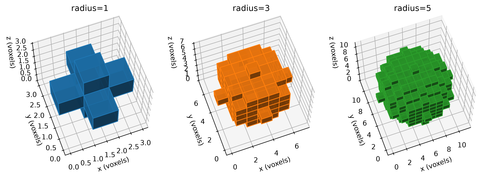

# Spheres

We segment a sphere into very coarse voxel meshes.
The Python code used to generate the voxelations and figures
is included [below](#source).

## Segmentation

Objective: Create very coarse spheres of three successively more refined
resolutions, `radius=1`, `radius=3`, and `radius=5`, as shown below:

<figure>



<figcaption>

Sphere segmentations at selected resolutions, shown in the voxel domain.

</figcaption>
</figure>

The `radius=1` case has the following data structure,

<details>
<summary>The <code>radius_1</code> data structure</summary>

```python
spheres["radius_1"]

array([[[0, 0, 0],
        [0, 1, 0],
        [0, 0, 0]],

       [[0, 1, 0],
        [1, 1, 1],
        [0, 1, 0]],

       [[0, 0, 0],
        [0, 1, 0],
        [0, 0, 0]]], dtype=uint8)
```

</details>

Because of large size, the data structures for `sphere_3` and
`sphere_5` are not shown here.

These segmentations are saved to

* [spheres_radius_1.npy](spheres_radius_1.npy)
* [spheres_radius_3.npy](spheres_radius_3.npy)
* [spheres_radius_5.npy](spheres_radius_5.npy)

## `automesh`

`automesh` is used to convert the `.npy` segmentations into `.inp` meshes.

<details open>
<summary>The <code>radius=1</code> command and output</summary>

```sh
automesh mesh hex -i spheres_radius_1.npy -o spheres_radius_1.inp
<!-- cmdrun automesh mesh hex -i spheres_radius_1.npy -o spheres_radius_1.inp | ansifilter -->
```

</details>

<details open>
<summary>The <code>radius=3</code> command and output</summary>

```sh
automesh mesh hex -i spheres_radius_3.npy -o spheres_radius_3.inp
<!-- cmdrun automesh mesh hex -i spheres_radius_3.npy -o spheres_radius_3.inp | ansifilter -->
```

</details>

<details open>
<summary>The <code>radius=5</code> command and output</summary>

```sh
automesh mesh hex -i spheres_radius_5.npy -o spheres_radius_5.inp
<!-- cmdrun automesh mesh hex -i spheres_radius_5.npy -o spheres_radius_5.inp | ansifilter -->
```

</details>

## Mesh

The `spheres_radius_1.inp` file:

<details>
<summary>The <code>spheres_radius_1.inp</code> file</summary>

```sh
<!-- cmdrun cat spheres_radius_1.inp -->
```

</details>

Because of large size, the mesh structures for `sphere_3` and
`sphere_5` are not shown here.

## Source

### `spheres.py`

<details>
<summary><code>spheres.py</code></summary>

```python
<!-- cmdrun cat spheres.py -->
```

</details>

### `test_spheres.py`

<details>
<summary><code>test_spheres.py</code></summary>

```python
<!-- cmdrun cat test_spheres.py -->
```

</details>
