# Unit Tests

The following illustrates a subset of the cases used to validate the code
implementation's voxel-to-mesh node numbering.  Validation of these cases is
performed by a `pytest` suite rather than `cargo test`; for the complete set
of gold-value checks, see
[examples_test.py](https://github.com/autotwin/automesh/blob/main/book/examples/unit_tests/examples_test.py).
The Python code used to generate the figures on this page is included
[below](#source), alongside `examples_test.py` in full.

**Remark:** We use the convention `np` when importing `numpy` as follows:

<details>
<summary>The NumPy import</summary>

```python
import numpy as np
```

</details>

### Single

The minimum working example (MWE) is a single voxel, used to create a single
mesh consisting of one block consisting of a single element.  The NumPy input
[single.npy](https://github.com/autotwin/automesh/raw/main/tests/input/single.npy)
contains the following segmentation:

<details>
<summary>The <code>single.npy</code> segmentation</summary>

```python
segmentation = np.array(
    [
        [
            [ 11, ],
        ],
    ],
    dtype=np.uint8,
)
```

</details>

where the segmentation `11` denotes block `11` in the finite element mesh.

**Remark:** Serialization (write and read)

| Write | Read |
|----------|----------|
| Use the [np.save](https://numpy.org/doc/stable/reference/generated/numpy.save.html) command to serialize the segmentation a `.npy` file  | Use the [np.load](https://numpy.org/doc/stable/reference/generated/numpy.load.html) command to deserialize the segmentation from a `.npy` file  |
*Example: Write the data in `segmentation` to a file called `seg.npy`*</br></br>`np.save("seg.npy", segmentation)` | *Example: Read the data from the file `seg.npy` to a variable called `loaded_array`*</br></br>`loaded_array = np.load("seg.npy")`

Equivalently, the [single.spn](https://raw.githubusercontent.com/autotwin/automesh/main/tests/input/single.spn) contains a
single integer:

<details>
<summary>The <code>.spn</code> segmentation</summary>

```sh
11   #  x:1  y:1  z:1
```

</details>

The resulting finite element mesh is visualized is shown in the following
figure:

<figure>

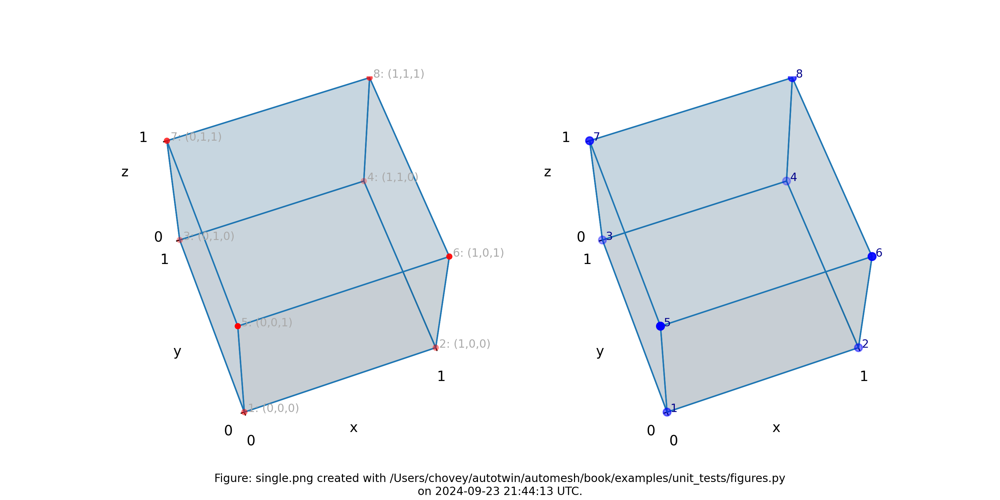

<figcaption>

The `single.png` visualization, (left) lattice node numbers, (right)
mesh node numbers.  Lattice node numbers appear in gray, with `(x, y, z)`
indices in parenthesis.  The right-hand rule is used.  Lattice coordinates
start at `(0, 0, 0)`, and proceed along the `x-axis`, then
the `y-axis`, and then the `z-axis`.

</figcaption>
</figure>

The finite element mesh local node numbering map to the following global node
numbers identically,
$S_{\rm{local}} = \{1, 2, 4, 3, 5, 6, 8, 7\}$ and $S_{\rm{local}} = S_{\rm{global}}$:

<details>
<summary>The local-to-global node map</summary>

```bash
[1, 2, 4, 3, 5, 6, 8, 7]
->
[1, 2, 4, 3, 5, 6, 8, 7]
```

</details>

which is a special case not typically observed, as shown in more complex
examples below.

**Remark:** Input `.npy` and `.spn` files for the examples below can be found on the repository at [automesh/tests/input](https://github.com/autotwin/automesh/tree/main/tests/input).

## Double

The next level of complexity example is a two-voxel domain, used to create
a single block composed of two finite elements.  We test propagation in
both the `x` and `y` directions.  The figures below show these two
meshes.

### Double X

<details>
<summary>The <code>.spn</code> segmentation</summary>

```sh
11   #  x:1  y:1  z:1
11   #    2    1    1
```

</details>

where the segmentation `11` denotes block `11` in the finite element mesh.

<figure>

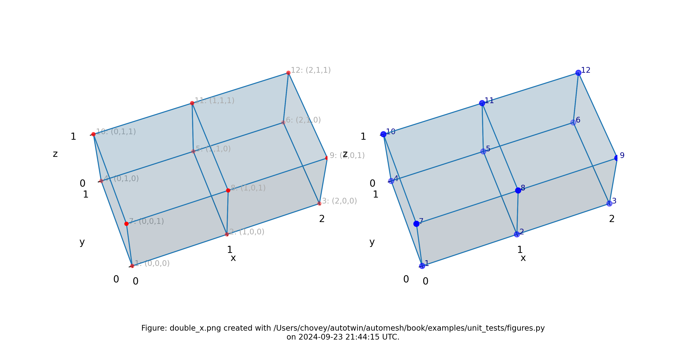

<figcaption>

Mesh composed of a single block with two elements, propagating along
the `x-axis`, (left) lattice node numbers, (right) mesh node numbers.

</figcaption>
</figure>

### Double Y

<details>
<summary>The <code>.spn</code> segmentation</summary>

```sh
11   #  x:1  y:1  z:1
11   #    1    2    1
```

</details>

where the segmentation `11` denotes block `11` in the finite element mesh.

<figure>

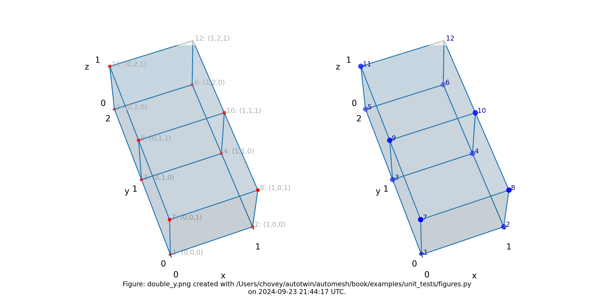

<figcaption>

Mesh composed of a single block with two elements, propagating along
the `y-axis`, (left) lattice node numbers, (right) mesh node numbers.

</figcaption>
</figure>

## Triple

<details>
<summary>The <code>.spn</code> segmentation</summary>

```sh
11   #  x:1  y:1  z:1
11   #    2    1    1
11   #    3    1    1
```

</details>

where the segmentation `11` denotes block `11` in the finite element mesh.

<figure>

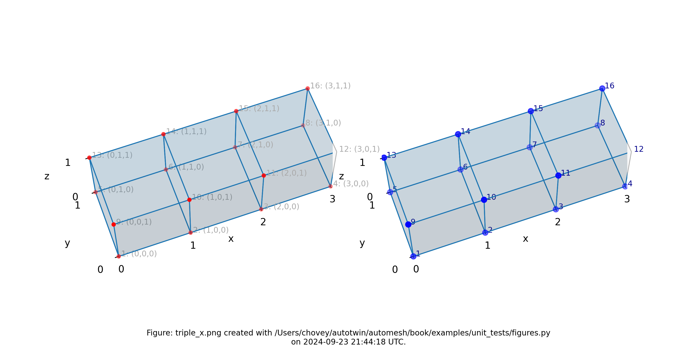

<figcaption>

Mesh composed of a single block with three elements, propagating along
the `x-axis`, (left) lattice node numbers, (right) mesh node numbers.

</figcaption>
</figure>

## Quadruple

<details>
<summary>The <code>.spn</code> segmentation</summary>

```sh
11   #  x:1  y:1  z:1
11   #    2    1    1
11   #    3    1    1
11   #    4    1    1
```

</details>

where the segmentation `11` denotes block `11` in the finite element mesh.

<figure>

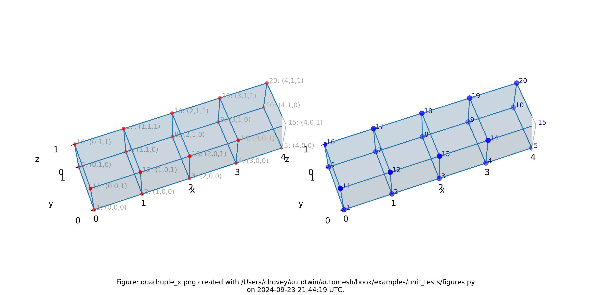

<figcaption>

Mesh composed of a single block with four elements, propagating along
the `x-axis`, (left) lattice node numbers, (right) mesh node numbers.

</figcaption>
</figure>

## Quadruple with Voids

<details>
<summary>The <code>.spn</code> segmentation</summary>

```sh
99   #  x:1  y:1  z:1
0    #    2    1    1
0    #    3    1    1
99   #    4    1    1
```

</details>

where the segmentation `99` denotes block `99` in the finite element mesh, and segmentation `0` is excluded from the mesh.

<figure>

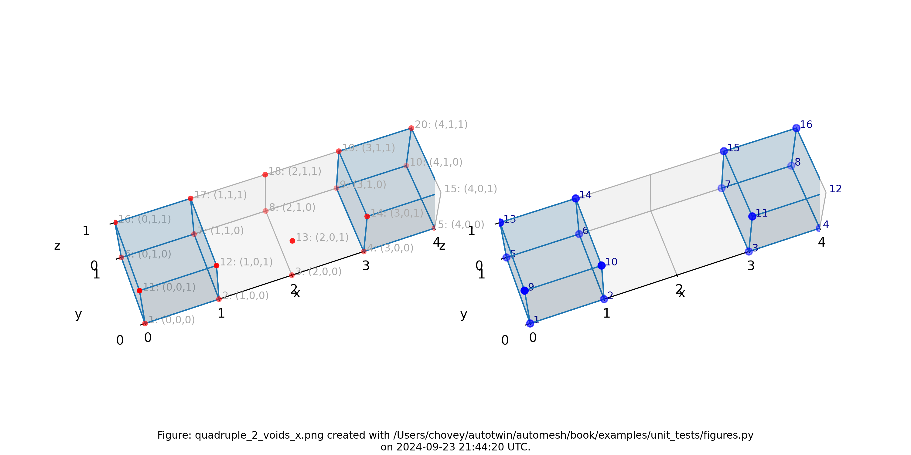

<figcaption>

Mesh composed of a single block with two elements, propagating along
the `x-axis` and two voids, (left) lattice node numbers, (right) mesh node
numbers.

</figcaption>
</figure>

## Quadruple with Two Blocks

<details>
<summary>The <code>.spn</code> segmentation</summary>

```sh
100  #  x:1  y:1  z:1
101  #    2    1    1
101  #    3    1    1
100  #    4    1    1
```

</details>

where the segmentation `100` and `101` denotes block `100` and `101`,
respectively in the finite element mesh.

<figure>

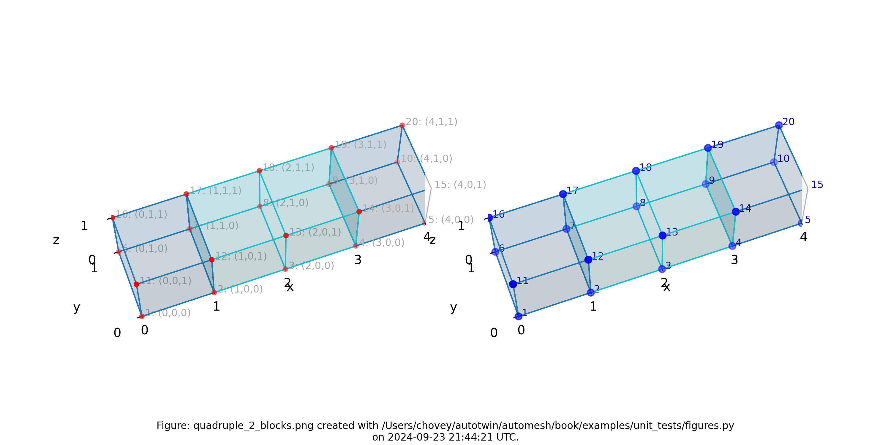

<figcaption>

Mesh composed of two blocks with two elements elements each,
propagating along the `x-axis`, (left) lattice node numbers, (right) mesh
node numbers.

</figcaption>
</figure>

## Quadruple with Two Blocks and Void

<details>
<summary>The <code>.spn</code> segmentation</summary>

```sh
102  #  x:1  y:1  z:1
103  #    2    1    1
0    #    3    1    1
102  #    4    1    1
```

</details>

where the segmentation `102` and `103` denotes block `102` and `103`,
respectively, in the finite element mesh, and segmentation `0` is excluded from the mesh.

<figure>

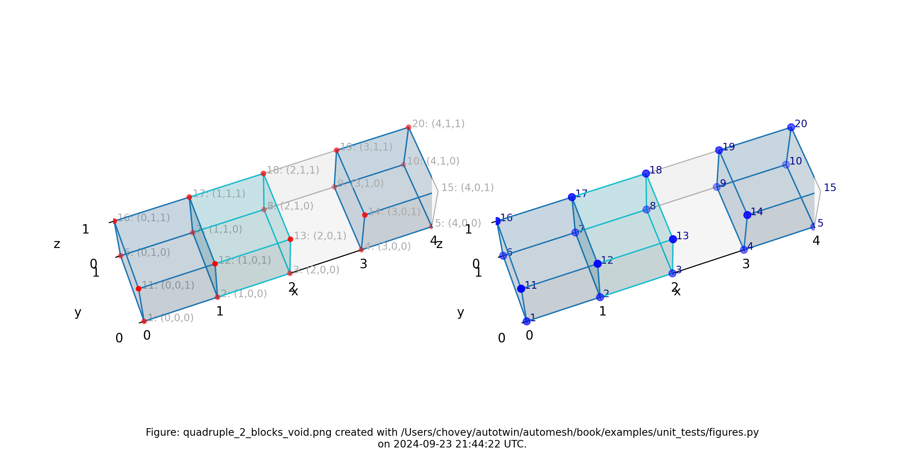

<figcaption>

Mesh composed of one block with two elements, a second block with one
element, and a void, propagating along the `x-axis`, (left) lattice node
numbers, (right) mesh node numbers.

</figcaption>
</figure>

## Cube

<details>
<summary>The <code>.spn</code> segmentation</summary>

```sh
11   #  x:1  y:1  z:1
11   #  _ 2  _ 1    1
11   #    1    2    1
11   #  _ 2  _ 2  _ 1
11   #    1    1    2
11   #  _ 2  _ 1    2
11   #    1    2    2
11   #  _ 2  _ 2  _ 2
```

</details>

where the segmentation `11` denotes block `11` in the finite element mesh.

<figure>

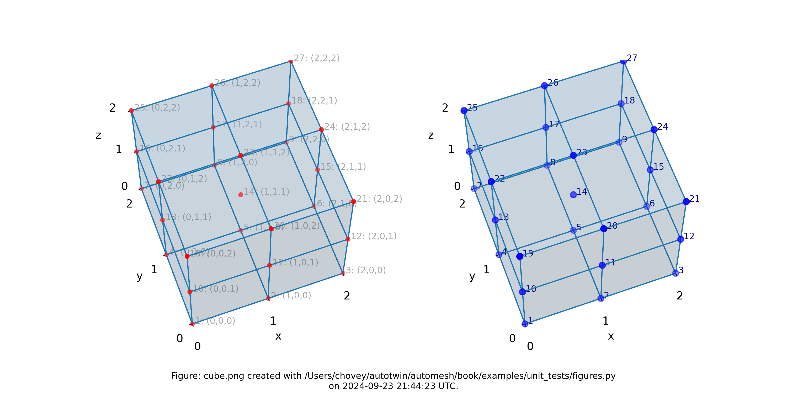

<figcaption>

Mesh composed of one block with eight elements, (left) lattice node
numbers, (right) mesh node numbers.

</figcaption>
</figure>

## Cube with Multi Blocks and Void

<details>
<summary>The <code>.spn</code> segmentation</summary>

```sh
82   #  x:1  y:1  z:1
2    #  _ 2  _ 1    1
2    #    1    2    1
2    #  _ 2  _ 2  _ 1
0    #    1    1    2
31   #  _ 2  _ 1    2
0    #    1    2    2
44   #  _ 2  _ 2  _ 2
```

</details>

where the segmentation `82`, `2`, `31` and `44` denotes block `82`, `2`, `31`
and `44`, respectively, in the finite element mesh, and segmentation `0` will
be included from the finite element mesh.

<figure>

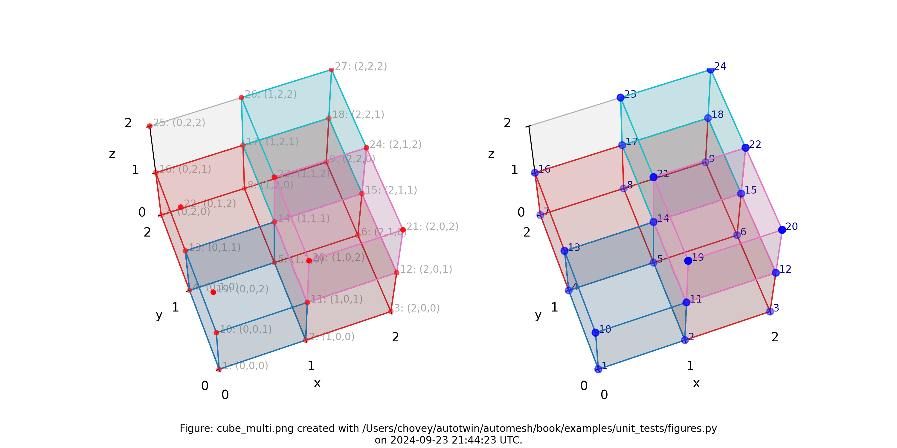

<figcaption>

Mesh composed of four blocks (block `82` has one element, block `2`
has three elements, block `31` has one element, and block `44` has one
element), (left) lattice node numbers, (right) mesh node numbers.

</figcaption>
</figure>

## Cube with Inclusion

<details>
<summary>The <code>.spn</code> segmentation</summary>

```sh
11   #  x:1  y:1  z:1
11   #    2    1    1
11   #  _ 3  _ 1    1
11   #    1    2    1
11   #    2    2    1
11   #  _ 3  _ 2    1
11   #    1    3    1
11   #    2    3    1
11   #  _ 3  _ 3  _ 1
11   #    1    1    2
11   #    2    1    2
11   #  _ 3  _ 1    2
11   #    1    2    2
88   #    2    2    2
11   #  _ 3  _ 2    2
11   #    1    3    2
11   #    2    3    2
11   #  _ 3  _ 3  _ 2
11   #    1    1    3
11   #    2    1    3
11   #  _ 3  _ 1    3
11   #    1    2    3
11   #    2    2    3
11   #  _ 3  _ 2    3
11   #    1    3    3
11   #    2    3    3
11   #  _ 3  _ 3  _ 3
````

</details>

<figure>

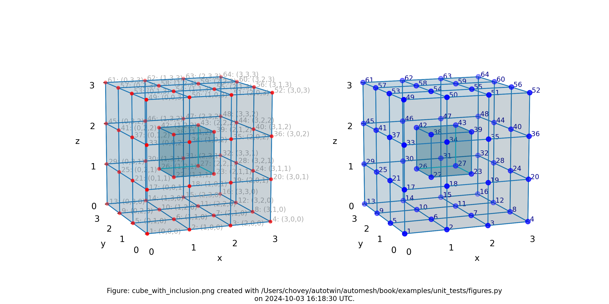

<figcaption>

Mesh composed of 26 voxels of (block `11`) and one voxel inslusion
(block `88`), (left) lattice node numbers, (right) mesh node numbers.

</figcaption>
</figure>

## Bracket

<details>
<summary>The <code>.spn</code> segmentation</summary>

```sh
1   #  x:1  y:1  z:1
1   #    2    1    1
1   #    3    1    1
1   #  _ 4  _ 1    1
1   #  x:1  y:2  z:1
1   #    2    2    1
1   #    3    2    1
1   #  _ 4  _ 2    1
1   #  x:1  y:3  z:1
1   #    2    3    1
0   #    3    3    1
0   #  _ 4  _ 3    1
1   #  x:1  y:4  z:1
1   #    2    4    1
0   #    3    4    1
0   #  _ 4  _ 4    1
```

</details>

where the segmentation `1` denotes block `1` in the finite element mesh,
and segmentation `0` is excluded from the mesh.

<figure>

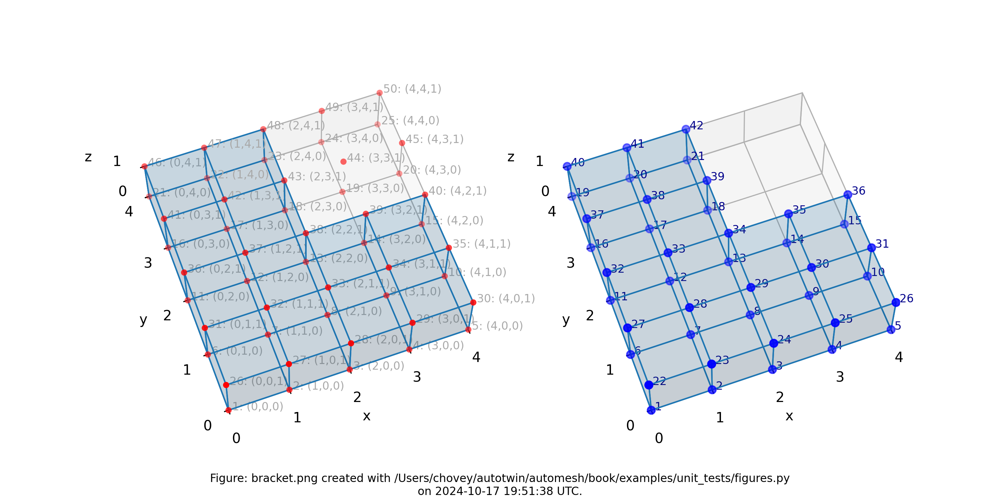

<figcaption>

Mesh composed of a L-shaped bracket in the `xy` plane.

</figcaption>
</figure>

## Letter F

<details>
<summary>The <code>.spn</code> segmentation</summary>

```sh
11   #  x:1  y:1  z:1
0    #    2    1    1
0    #  _ 3  _ 1    1
11   #    1    2    1
0    #    2    2    1
0    #  _ 3  _ 2    1
11   #    1    3    1
11   #    2    3    1
0    #  _ 3  _ 3    1
11   #    1    4    1
0    #    2    4    1
0    #  _ 3  _ 4    1
11   #    1    5    1
11   #    2    5    1
11   #  _ 3  _ 5  _ 1
```

</details>

where the segmentation `11` denotes block `11` in the finite element mesh.

<figure>

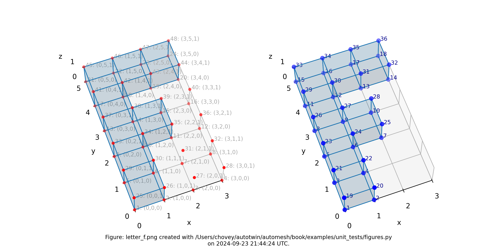

<figcaption>

Mesh composed of a single block with eight elements, (left) lattice
node numbers, (right) mesh node numbers.

</figcaption>
</figure>

## Letter F in 3D

<details>
<summary>The <code>.spn</code> segmentation</summary>

```sh
1    #  x:1  y:1  z:1
1    #    2    1    1
1    #    3    1    1
1    #  _ 4  _ 1    1
1    #    1    2    1
1    #    2    2    1
1    #    3    2    1
1    #  _ 4  _ 2    1
1    #    1    3    1
1    #    2    3    1
1    #    3    3    1
1    #  _ 4  _ 3    1
1    #    1    4    1
1    #    2    4    1
1    #    3    4    1
1    #  _ 4  _ 4    1
1    #    1    5    1
1    #    2    5    1
1    #    3    5    1
1    #  _ 4  _ 5  _ 1
1    #  x:1  y:1  z:2
0    #    2    1    2
0    #    3    1    2
0    #  _ 4  _ 1    2
1    #    1    2    2
0    #    2    2    2
0    #    3    2    2
0    #  _ 4  _ 2    2
1    #    1    3    2
1    #    2    3    2
1    #    3    3    2
1    #  _ 4  _ 3    2
1    #    1    4    2
0    #    2    4    2
0    #    3    4    2
0    #  _ 4  _ 4    2
1    #    1    5    2
1    #    2    5    2
1    #    3    5    2
1    #  _ 4  _ 5  _ 2
1    #  x:1  y:1  z:3
0    #    2    1    j
0    #    3    1    2
0    #  _ 4  _ 1    2
1    #    1    2    3
0    #    2    2    3
0    #    3    2    3
0    #  _ 4  _ 2    3
1    #    1    3    3
0    #    2    3    3
0    #    3    3    3
0    #  _ 4  _ 3    3
1    #    1    4    3
0    #    2    4    3
0    #    3    4    3
0    #  _ 4  _ 4    3
1    #    1    5    3
1    #    2    5    3
1    #    3    5    3
1    #  _ 4  _ 5  _ 3
```

</details>

which corresponds to `--nelx 4`, `--nely 5`, and `--nelz  3` in the
[command line interface](../../cli.md).

<figure>

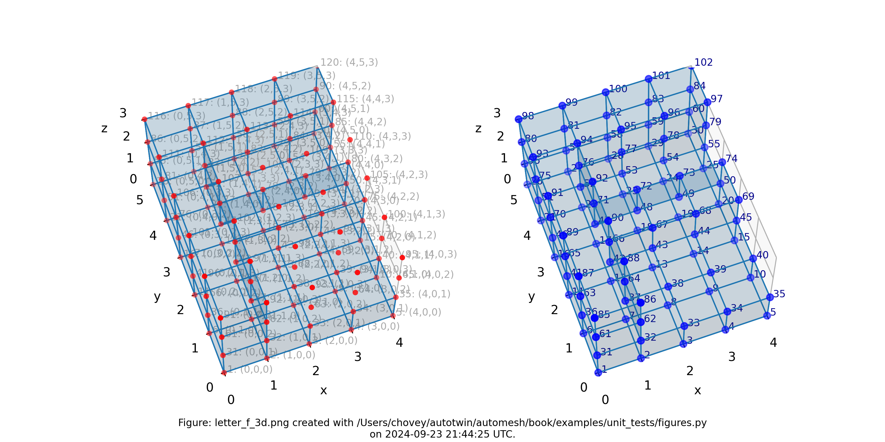

<figcaption>

Mesh composed of a single block with thirty-nine elements, (left)
lattice node numbers, (right) mesh node numbers.

</figcaption>
</figure>

The shape of the solid segmentation is more easily seen without the
lattice and element nodes, and with decreased opacity, as shown below:

<figure>

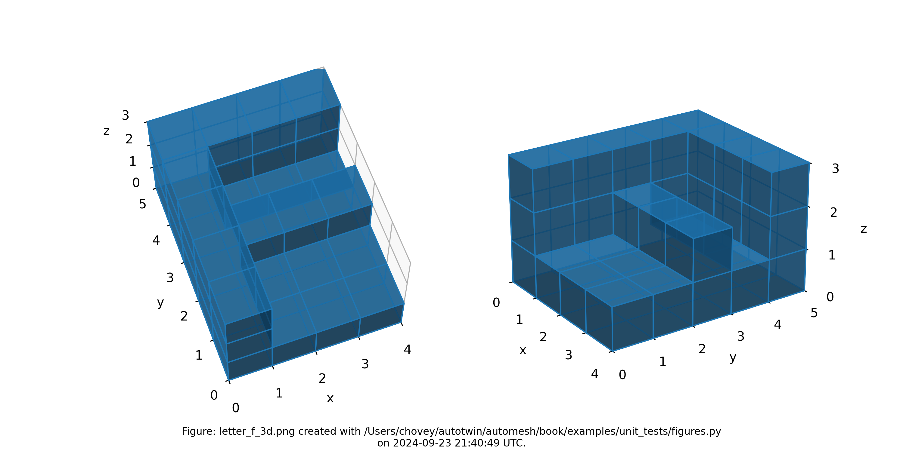

<figcaption>

Mesh composed of a single block with thirty-nine elements, shown
with decreased opacity and without lattice and element node numbers.

</figcaption>
</figure>

## Sparse

<details>
<summary>The <code>.spn</code> segmentation</summary>

```sh
0    #  x:1  y:1  z:1
0    #    2    1    1
0    #    3    1    1
0    #    4    1    1
2    #  _ 5  _ 1    1
0    #    1    2    1
1    #    2    2    1
0    #    3    2    1
0    #    4    2    1
2    #  _ 5  _ 2    1
1    #    1    3    1
2    #    2    3    1
0    #    3    3    1
2    #    4    3    1
0    #  _ 5  _ 3    1
0    #    1    4    1
1    #    2    4    1
0    #    3    4    1
2    #    4    4    1
0    #  _ 5  _ 4    1
1    #    1    5    1
0    #    2    5    1
0    #    3    5    1
0    #    4    5    1
1    #  _ 5  _ 5  _ 1
2    #  x:1  y:1  z:2
0    #    2    1    2
2    #    3    1    2
0    #    4    1    2
0    #  _ 5  _ 1    2
1    #    1    2    2
1    #    2    2    2
0    #    3    2    2
2    #    4    2    2
2    #  _ 5  _ 2    2
2    #    1    3    2
0    #    2    3    2
0    #    3    3    2
0    #    4    3    2
0    #  _ 5  _ 3    2
1    #    1    4    2
0    #    2    4    2
0    #    3    4    2
2    #    4    4    2
0    #  _ 5  _ 4    2
2    #    1    5    2
0    #    2    5    2
2    #    3    5    2
0    #    4    5    2
2    #  _ 5  _ 5  _ 2
0    #  x:1  y:1  z:3
0    #    2    1    3
1    #    3    1    3
0    #    4    1    3
2    #  _ 5  _ 1    3
0    #    1    2    3
0    #    2    2    3
0    #    3    2    3
1    #    4    2    3
2    #  _ 5  _ 2    3
0    #    1    3    3
0    #    2    3    3
2    #    3    3    3
2    #    4    3    3
2    #  _ 5  _ 3    3
0    #    1    4    3
0    #    2    4    3
1    #    3    4    3
0    #    4    4    3
1    #  _ 5  _ 4    3
0    #    1    5    3
1    #    2    5    3
0    #    3    5    3
1    #    4    5    3
0    #  _ 5  _ 5  _ 3
0    #  x:1  y:1  z:4
1    #    2    1    4
2    #    3    1    4
1    #    4    1    4
2    #  _ 5  _ 1    4
2    #    1    2    4
0    #    2    2    4
2    #    3    2    4
0    #    4    2    4
1    #  _ 5  _ 2    4
1    #    1    3    4
2    #    2    3    4
2    #    3    3    4
0    #    4    3    4
0    #  _ 5  _ 3    4
2    #    1    4    4
1    #    2    4    4
1    #    3    4    4
1    #    4    4    4
1    #  _ 5  _ 4    4
0    #    1    5    4
0    #    2    5    4
1    #    3    5    4
0    #    4    5    4
0    #  _ 5  _ 5  _ 4
0    #  x:1  y:1  z:5
1    #    2    1    5
0    #    3    1    5
2    #    4    1    5
0    #  _ 5  _ 1    5
1    #    1    2    5
0    #    2    2    5
0    #    3    2    5
0    #    4    2    5
2    #  _ 5  _ 2    5
0    #    1    3    5
1    #    2    3    5
0    #    3    3    5
0    #    4    3    5
0    #  _ 5  _ 3    5
1    #    1    4    5
0    #    2    4    5
0    #    3    4    5
0    #    4    4    5
0    #  _ 5  _ 4    5
0    #    1    5    5
0    #    2    5    5
1    #    3    5    5
2    #    4    5    5
1    #  _ 5  _ 5  _ 5
```

</details>

where the segmentation `1` denotes block `1` and segmentation `2` denotes block `2` in the finite eelement mesh (with segmentation `0` excluded).

<figure>

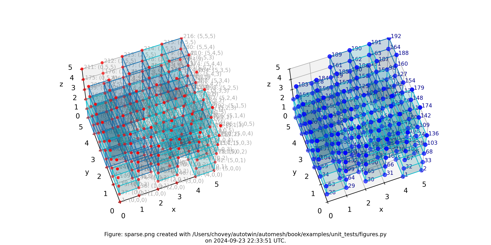

<figcaption>

Sparse mesh composed of two materials at random voxel locations.

</figcaption>
</figure>

<figure>

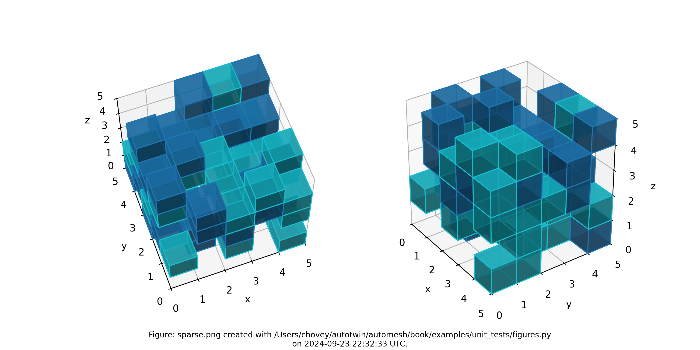

<figcaption>

Sparse mesh composed of two materials at random voxel locations, shown with decreased opactity and without lattice and element node numbers.

</figcaption>
</figure>

## Source

The figures were created with the following Python files:

* [examples_data.py](examples_data.py)
* [examples_figures.py](examples_figures.py)
* [examples_test.py](examples_test.py)
* [examples_types.py](examples_types.py)

### `examples_data.py`

<details>
<summary><code>examples_data.py</code></summary>

```python
<!-- cmdrun cat examples_data.py -->
```

</details>

### `examples_figures.py`

<details>
<summary><code>examples_figures.py</code></summary>

```python
<!-- cmdrun cat examples_figures.py -->
```

</details>

### `examples_test.py`

<details>
<summary><code>examples_test.py</code></summary>

```python
<!-- cmdrun cat examples_test.py -->
```

</details>

### `examples_types.py`

<details>
<summary><code>examples_types.py</code></summary>

```python
<!-- cmdrun cat examples_types.py -->
```

</details>
