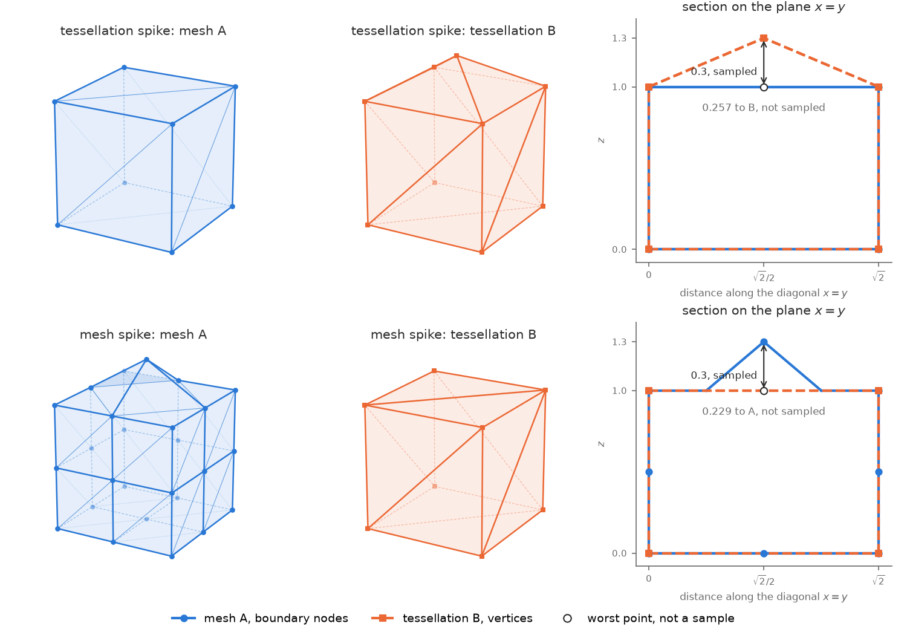

# Hausdorff Distance

The Hausdorff distance measures the worst-case gap between two surfaces.
It is the largest distance from any point on one surface to the nearest point on the other.
[`automesh hausdorff`](../cli/hausdorff.md) uses it to compare the surface of a finite element mesh with the tessellation (STL) it came from.

Consider two closed and bounded continuous surfaces, $\mathcal{A}$ on the subject body and $\mathcal{B}$.
Their discrete counterparts are the boundary $\partial \Omega_h$ of the mesh $\Omega_h$ and the tessellation surface $\Gamma_h$.

## Definitions

**Point distance.**
Let $d: \mathbb{R}^3 \times \mathbb{R}^3 \rightarrow \mathbb{R}_{\ge 0}$ be the Euclidean distance between a point $\boldsymbol{a}$ on $\mathcal{A}$ and a point $\boldsymbol{b}$ on $\mathcal{B}$:

$$
d(\boldsymbol{a}, \boldsymbol{b}) = \lVert \boldsymbol{a} - \boldsymbol{b} \rVert_2.
$$

**Point-to-surface distance.**
The distance from a point $\boldsymbol{a}$ to the surface $\mathcal{B}$ is the smallest point distance:

$$
d(\boldsymbol{a}, \mathcal{B}) = \min_{\boldsymbol{b} \in \mathcal{B}} d(\boldsymbol{a}, \boldsymbol{b}).
$$

On a tessellation, the closest point can lie inside a triangle, on an edge, or on a vertex.

**Directed Hausdorff distance.**
The directed distance $h(\mathcal{A} \rightarrow \mathcal{B})$ is the largest point-to-surface distance:

$$
h(\mathcal{A} \rightarrow \mathcal{B}) = \max_{\boldsymbol{a} \in \mathcal{A}} d(\boldsymbol{a}, \mathcal{B}).
$$

It carries the units of the mesh coordinates.
It answers one question: from the worst-placed point on $\mathcal{A}$, how far away is the nearest point on $\mathcal{B}$?
In general $h(\mathcal{A} \rightarrow \mathcal{B}) \ne h(\mathcal{B} \rightarrow \mathcal{A})$, which is why it is called directed.

**Hausdorff distance.**
The Hausdorff distance is the larger of the two directed distances:

$$
H(\mathcal{A}, \mathcal{B}) = \max\left( h(\mathcal{A} \rightarrow \mathcal{B}),\ h(\mathcal{B} \rightarrow \mathcal{A}) \right).
$$

$H$ is symmetric, so $H(\mathcal{A}, \mathcal{B}) = H(\mathcal{B}, \mathcal{A})$.

## Discrete Setting

`automesh` evaluates $d(\boldsymbol{a}, \mathcal{B})$ exactly, but only at a finite set of sample points.

* Mesh to tessellation: the samples are the boundary nodes $\boldsymbol{x}_i$ of $\Omega_h$, for $i = 1, \dots, N$.
* Tessellation to mesh: the samples are the vertices $\boldsymbol{v}_j$ of $\Gamma_h$, for $j = 1, \dots, M$.

Each sample is a point on its surface.
The maximum over a subset of points cannot exceed the maximum over the whole surface.
Each sampled directed distance is therefore a lower bound:

$$
h_h(\mathcal{A} \rightarrow \mathcal{B}) = \max_{i} \lvert s_i \rvert \le h(\mathcal{A} \rightarrow \mathcal{B}),
\qquad
h_h(\mathcal{B} \rightarrow \mathcal{A}) = \max_{j} \lvert s_j \rvert \le h(\mathcal{B} \rightarrow \mathcal{A}),
$$

where $s_i$ and $s_j$ are the signed distances defined under [Sign Convention](#sign-convention).
The sampled Hausdorff distance is

$$
H_h = \max\left( h_h(\mathcal{A} \rightarrow \mathcal{B}),\ h_h(\mathcal{B} \rightarrow \mathcal{A}) \right) \le H(\mathcal{A}, \mathcal{B}).
$$

The interior of a face can lie farther from the other surface than any of its corners.
Node and vertex samples miss that gap.
The [Unit Cube Example](#unit-cube-example) shows a gap of 0.257 that the samples miss.

## Unit Cube Example

The two directed distances ask different questions.
$h(\mathcal{A} \rightarrow \mathcal{B})$ asks whether every part of the mesh surface lies near the tessellation.
$h(\mathcal{B} \rightarrow \mathcal{A})$ asks whether every part of the tessellation lies near the mesh surface.
A mesh can pass the first test and fail the second.

Four cases on the unit cube $[0, 1]^3$ show this.
Each case moves one point, the center of the top face at $(0.5, 0.5, 1)$, along $z$ by 0.3.
A spike moves it out to $z = 1.3$, and a dimple moves it in to $z = 0.7$.

| Case | Mesh $\mathcal{A}$ | Tessellation $\mathcal{B}$ |
| --- | --- | --- |
| tessellation spike | one hexahedron | the cube, with its top face replaced by four triangles that meet at an apex at $z = 1.3$ |
| tessellation dimple | one hexahedron | the same, with the apex at $z = 0.7$ |
| mesh spike | a $2 \times 2 \times 2$ grid of hexahedra, with the top-center node at $z = 1.3$ | the cube as 12 triangles |
| mesh dimple | the same grid, with the top-center node at $z = 0.7$ | the cube as 12 triangles |

<figure>



<figcaption>

The two spike cases.
Mesh $\mathcal{A}$ is blue, with its boundary nodes as dots.
Thin blue lines split each boundary quadrilateral into the two triangles described under [Surface Triangulation](#surface-triangulation).
Tessellation $\mathcal{B}$ is orange, with its vertices as squares.
Light dashed lines and faded markers lie on the far side of a surface, hidden from this view.
The right column cuts both surfaces with the diagonal plane $x = y$.
That plane passes through the moved point, two cube edges, and every sample that lies on the diagonal.
The hollow circle marks the point that lies farthest from the other surface without being a sample.

</figcaption>
</figure>

The table lists what `automesh hausdorff` reports, the sampled distances, next to the continuous distances.
The sampled columns give the signed value with the largest magnitude.
The continuous columns come from a dense grid of points on each surface.

| Case | $h_h(\mathcal{A} \rightarrow \mathcal{B})$ | $h_h(\mathcal{B} \rightarrow \mathcal{A})$ | $H_h$ | $h(\mathcal{A} \rightarrow \mathcal{B})$ | $h(\mathcal{B} \rightarrow \mathcal{A})$ | $H$ |
| --- | ---: | ---: | ---: | ---: | ---: | ---: |
| tessellation spike | 0 | +0.3 | 0.3 | 0.257 | 0.3 | 0.3 |
| tessellation dimple | 0 | −0.3 | 0.3 | 0.257 | 0.3 | 0.3 |
| mesh spike | +0.3 | 0 | 0.3 | 0.3 | 0.229 | 0.3 |
| mesh dimple | −0.3 | 0 | 0.3 | 0.3 | 0.229 | 0.3 |

**Tessellation spike.**
Every node of the hexahedron is a cube corner, and every cube corner is a vertex of $\mathcal{B}$.
So every mesh-to-tessellation sample is 0, and $h_h(\mathcal{A} \rightarrow \mathcal{B}) = 0$.
The apex of $\mathcal{B}$ lies 0.3 above the top face of the mesh, so $h_h(\mathcal{B} \rightarrow \mathcal{A}) = 0.3$.
A mesh-to-tessellation check alone would report 0 for a mesh that left out a feature.

**Mesh spike.**
The roles swap.
The moved node lies 0.3 above the top face of $\mathcal{B}$, so $h_h(\mathcal{A} \rightarrow \mathcal{B}) = 0.3$.
Every vertex of $\mathcal{B}$ is a cube corner, and every corner is a node of the mesh, so $h_h(\mathcal{B} \rightarrow \mathcal{A}) = 0$.
A tessellation-to-mesh check alone would report 0 for a mesh that grew a feature.
`automesh hausdorff` computes both directions for this reason.

**Dimples.**
The dimples give the same magnitudes as the spikes.
The sign turns negative, because the moved point lies inside the other surface.

**Points between the samples.**
The center of the mesh's top face is not a node in the tessellation spike case.
It lies $0.15 / \sqrt{0.34} \approx 0.257$ from the nearest face of the apex.
The sampled $h_h(\mathcal{A} \rightarrow \mathcal{B}) = 0$ misses that gap entirely.
In the mesh spike case, the center of the tessellation's top face is not a vertex.
It lies 0.229 from the mesh surface, and the sampled $h_h(\mathcal{B} \rightarrow \mathcal{A}) = 0$ misses it too.
The value 0.229 depends on the triangulation of the mesh's top quadrilaterals.
Each of those quadrilaterals has one raised corner, and the shorter-diagonal rule keeps the raised corner out of the split.

In all four cases $H_h = H = 0.3$, because the moved point is itself a sample, and it carries the largest gap.
A blunt feature with no node or vertex at its tip would not give $H_h = H$.

The tests in `tests/cli.rs` run `automesh hausdorff` on these four cases, for hexahedra and for tetrahedra.
`tests/input/hausdorff_cube.py` writes their input files.

<details>
<summary><code>hausdorff_figures.py</code></summary>

```python
<!-- cmdrun cat hausdorff/hausdorff_figures.py -->
```

</details>

## Sign Convention

`automesh` reports a signed distance $s$ at each sample.
Positive means the sample lies outside the other surface, and negative means inside.
This matches the level-set convention and the [libigl](https://github.com/libigl/libigl) `signed_distance` convention.

Let $\boldsymbol{p}$ be the closest point to the sample $\boldsymbol{x}$ on the other surface.
Let $\boldsymbol{n}$ be the outward unit normal of the triangle that contains $\boldsymbol{p}$.
Then

$$
s = \mathrm{sign}\left( (\boldsymbol{x} - \boldsymbol{p}) \cdot \boldsymbol{n} \right) \, d(\boldsymbol{x}, \boldsymbol{p}).
$$

A sample exactly on the surface has $s = 0$.
The Hausdorff distance itself is unsigned, so $h_h$ uses $\lvert s \rvert$.

`automesh` computes $\boldsymbol{n}$ from the triangle winding.
It ignores the facet normals stored in the STL file, because some writers leave them zero or wrong.

**Known limit.**
Near a sharp convex edge or vertex, the normal of one triangle can give the wrong sign.
Angle-weighted pseudonormals would remove this error.
`conspire` does not provide them today.

<!-- TODO: update after the 2026-10-15 discussion of questions Q2 and Q3 with @mrbuche (automesh#761). -->

## Surface Triangulation

The tessellation-to-mesh direction measures distances to $\partial \Omega_h$.
`automesh` represents $\partial \Omega_h$ as triangles.
The exterior faces of a tetrahedral mesh are triangles already.
Each exterior face of a hexahedral mesh is a quadrilateral $[n_0, n_1, n_2, n_3]$, which `automesh` splits into two triangles.

The split runs along the shorter diagonal:

* If $\lVert \boldsymbol{x}_{n_1} - \boldsymbol{x}_{n_3} \rVert < \lVert \boldsymbol{x}_{n_0} - \boldsymbol{x}_{n_2} \rVert$, the triangles are $[n_0, n_1, n_3]$ and $[n_1, n_2, n_3]$.
* Otherwise, the triangles are $[n_0, n_1, n_2]$ and $[n_0, n_2, n_3]$.

Both triangles keep the winding of the quadrilateral, so their normals point outward.

The rule picks the shorter diagonal for two reasons.
It makes the result deterministic.
It also gives better-shaped triangles than the longer diagonal.
When the two diagonals have equal length, the rule picks $n_0$–$n_2$.
The comparison is exact, so the same input always gives the same split.

A warped quadrilateral is not planar, so its two triangles depend on the diagonal.
The error this adds to a distance is bounded by how far the face departs from a plane.

## Input Requirements

The sign convention needs a well-defined inside and outside for each surface.
`automesh hausdorff` rejects any input that does not have one.

### Surface Checks

`automesh` runs three checks on each surface: the tessellation, and the triangulated boundary of the mesh.

* **Closed.** Every edge must belong to exactly two triangles. An edge with one triangle means a hole, and an edge with three or more means a non-manifold surface.
* **Consistently wound.** The two triangles that share an edge must traverse it in opposite directions.
* **Outward.** The surface must enclose a positive volume. A negative volume means every normal points inward, so the surface is inside out.

A surface that fails any check stops the command with an error.
Fix the input upstream, then rerun.

`automesh` checks the tessellation after it merges vertices with identical coordinates.
A tessellation whose shared vertices differ by round-off therefore fails the closed check.

### Inverted Elements

Element orientation matters only for the tessellation-to-mesh direction.
That direction takes its signs from the winding of the mesh's exterior faces.
The mesh-to-tessellation direction takes its signs from the tessellation, so element orientation never affects it.
An inverted element in the interior of the mesh touches neither direction.

An inverted element on the boundary falls into one of three cases.

| Case | Example cause | Boundary surface | `automesh hausdorff` |
| --- | --- | --- | --- |
| Mirrored mesh | a writer that lists every element's nodes in left-handed order | consistently wound, but every normal points inward, so the enclosed volume is negative | rejects the mesh: it fails the outward check |
| Mirrored boundary elements | some elements listed in left-handed order | wound inconsistently along each edge where a mirrored face meets a normal one | rejects the mesh: it fails the consistently wound check |
| Tangled boundary elements | smoothing that folds an element, so $\hat{J}_{\min} < 0$ at some corners | consistently wound and outward, but folded | accepts the mesh, writes both files, and reports the number of boundary elements with $\hat{J}_{\min} < 0$ |

`automesh` does not flip a mirrored mesh to repair it.
A mirrored mesh points to a bug upstream, such as in the writer that produced it, and a silent flip would hide that bug.

A tangled mesh still gets its distances, because each distance stays exact.
Only the signs of samples near the fold are suspect.
Rejecting a tangled mesh would block this diagnostic exactly when you need it, such as right after `automesh smooth`.
[`automesh metrics`](../cli/metrics.md) lists $\hat{J}_{\min}$ for each element, so you can find the folded ones.

### Frame of Reference

The tessellation and the mesh must use the same frame of reference.
`automesh hausdorff` does not check this.
See [Frame of Reference](../cli/hausdorff.md#frame-of-reference).
